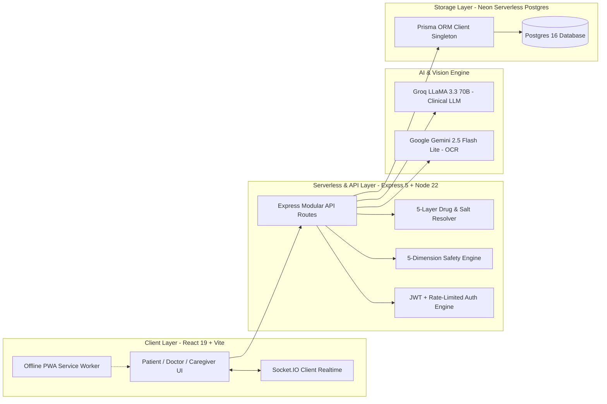

# 🛡️ PolySafe — The Complete A-to-Z Master Guide & Hackathon Playbook

> **Welcome to the PolySafe Team Bible!**  
> This document explains **everything** about the PolySafe project in **simple, everyday English**.  
> Every team member should read this once. By the time you finish, you will know the exact problem, the mathematics, the technical architecture, and the live demo steps. In front of the judges, nobody on your team will be stuck or lack an answer!

---

## 📑 Table of Contents
1. [What is PolySafe in Plain English?](#1-what-is-polysafe-in-plain-english)
2. [The Big Problem (Why PolySafe Must Exist)](#2-the-big-problem-why-polysafe-must-exist)
3. [All Scores & Mathematical Logic (Maths First)](#3-all-scores--mathematical-logic-maths-first)
   - [3.1 Regimen Risk Score (Level 1 to 5)](#31-regimen-risk-score-level-1-to-level-5)
   - [3.2 Anticholinergic Cognitive Burden (ACB Score: 0 to 12+)](#32-anticholinergic-cognitive-burden-acb-score-0-to-12)
   - [3.3 DDInter Interaction Severity & Weights](#33-ddinter-interaction-severity--weights)
   - [3.4 Duplicate Salt Toxicity & Safe Ceiling Limits](#34-duplicate-salt-toxicity--safe-ceiling-limits)
   - [3.5 Prescribing Cascade Temporal Graph Traversal](#35-prescribing-cascade-temporal-graph-traversal)
   - [3.6 Rolling 7-Day Adherence Score & Streak](#36-rolling-7-day-adherence-score--streak)
   - [3.7 4-System Organ Toxicity Vector](#37-4-system-organ-toxicity-vector)
4. [The 5 Core Safety Subsystems (How PolySafe Solves It)](#4-the-5-core-safety-subsystems-how-polysafe-solves-it)
5. [The 3 User Portals (Patient, Doctor, Caregiver)](#5-the-3-user-portals-patient-doctor-caregiver)
6. [Complete Technical Architecture & Cloud Stack](#6-complete-technical-architecture--cloud-stack)
7. [Live Deployment & Verified Demo Accounts](#7-live-deployment--verified-demo-accounts)
8. [5-Person Team Role Division (Exact Scripts & Screen Clicks)](#8-5-person-team-role-division-exact-scripts--screen-clicks)
9. [5-Minute Live Demo Timeline (Second-by-Second)](#9-5-minute-live-demo-timeline-second-by-second)
10. [Judge Defense Bible (Top 15 Tough Questions & Golden Answers)](#10-judge-defense-bible-top-15-tough-questions--golden-answers)
11. [Medical & Technical Glossary (Simple Explanations)](#11-medical--technical-glossary-simple-explanations)

---

## 1. What is PolySafe in Plain English?

Imagine your 70-year-old grandfather. 
* He goes to a **Heart Doctor (Cardiologist)** who prescribes *Warfarin* (a blood thinner for his heart).
* He goes to an **Orthopedic Doctor** for joint pain who prescribes *Aspirin* (another blood thinner).
* He visits an Ayurvedic shop and buys *Ginkgo Biloba* herbal tea for energy (also thins blood).

None of these doctors know what the other doctor prescribed. Three weeks later, your grandfather collapses in the bathroom with **internal stomach bleeding**. 

Why did this happen? 
Because **conventional medicine checkers only check 2 medicines at a time**. They completely miss what happens when you take **5, 8, or 10 medicines together**.

**PolySafe is an intelligent clinical platform that checks the WHOLE combination of medicines together in real-time.** 
It alerts patients, doctors, and family caregivers about:
1. **Lethal Drug-Drug Clashes** (e.g. Warfarin + Aspirin).
2. **Prescribing Cascades** (when a medicine's side-effect is misdiagnosed as a new disease).
3. **Hidden Overdoses in Indian Brands** (e.g. taking *Combiflam* and *Calpol* at the same time causes a double overdose of Paracetamol).
4. **Herbal & Food Clashes** (e.g. taking Calcium with thyroid medicine stops the thyroid medicine from working).
5. **Memory & Fall Risks (ACB Score)** that cause confusion and hip fractures in seniors.

---

## 2. The Big Problem (Why PolySafe Must Exist)

### The Staggering Numbers You Must Memorize
* **Polypharmacy**: Taking **5 or more** medications concurrently. Taking **10 or more** is called *Hyperpolypharmacy*.
* **Over 30% of emergency hospital admissions** in senior citizens (age 65+) are caused by **Adverse Drug Events (ADEs)**.
* **Over 50% of these hospital admissions are 100% preventable** if the patient's full regimen is screened in real time!

### The 4 Fatal Traps in Healthcare Today

#### Trap 1: Specialist Silos (Doctors Don't Talk to Each Other)
In modern cities, patients visit 3 or 4 different private clinics. Doctor A writes on one paper, Doctor B writes on another. No doctor has a single screen showing everything the patient is putting into their mouth.

#### Trap 2: The "Prescribing Cascade" Trap (The Vicious Cycle)
1. A patient takes **Amlodipine** for blood pressure.
2. Amlodipine causes a normal side effect: **swollen feet and ankles**.
3. The patient visits a second doctor. The second doctor doesn't realize it's a side effect and thinks: *"Oh, the patient has fluid buildup! Let me prescribe Furosemide (a water pill)!"*
4. The water pill dehydrates the patient and triggers **Gout pain**.
5. A third doctor prescribes **Allopurinol** for gout.
*Result*: One simple side-effect triggered a chain reaction of **3 extra unnecessary drugs**, damaging the patient's kidneys!

#### Trap 3: The Indian Multi-Salt Brand Masking Trap
In India, over 70% of pharmacy medicines are **Fixed-Dose Combinations (FDCs)** sold under fancy brand names:
* *Combiflam* contains: **Ibuprofen + Paracetamol**.
* *Calpol 650* contains: **Paracetamol**.
* *Zerodol-SP* contains: **Aceclofenac + Paracetamol + Serratiopeptidase**.
* *Pan-D* contains: **Pantoprazole + Domperidone**.

A normal patient with knee pain takes Combiflam in the morning. Later they get a mild headache and take Calpol. They just took a **toxic double dose of Paracetamol**, which can cause acute liver failure!

#### Trap 4: The Herbal & Dietary Blind Spot
Over 60% of patients never tell their doctor about Ayurvedic churna, herbal tea, or vitamin tablets because they believe: *"It's natural, so it has zero side effects."* 
In reality, herbs are powerful chemicals. *Ginkgo Biloba*, *Ashwagandha*, *St. John's Wort*, and even *Grapefruit juice* can stop blood thinners or blood pressure medicines from clearing the liver, causing fatal toxicity.

---

## 3. All Scores & Mathematical Logic (Maths First)

> **CRITICAL RULE**: In medical software, **math and deterministic clinical rules must ALWAYS come before AI**. PolySafe never lets an AI "guess" a score. Every score is calculated using exact mathematical equations and verified clinical datasets!

```
[Patient Active Medications M₁ ... M_N]
       │
       ├──► 1. Regimen Risk Formula ──────► μ_risk & h_max ──► Decision Tree ──► Level 1 to 5
       ├──► 2. ACB Cognitive Score ──────► TotalACB = ∑ Score(m_i) ───────────► Gauge (0 to 12+)
       ├──► 3. DDInter Interaction Flags ─► N(N-1)/2 Pairs ───────────────────► Weights (1 to 4)
       ├──► 4. Salt Toxicity Engine ─────► Cumulative Daily mg ───────────────► Safe Ceiling Limit
       ├──► 5. Prescribing Cascade ──────► Directed Time Graph (m_A → s → m_B) ► Cascade Match Flag
       ├──► 6. Dose Adherence Tracker ───► (Logged Doses / Scheduled) × 100 ──► Adherence % & Streak
       └──► 7. Organ Clearance Vector ───► [Renal, Hepatic, Cardio, CNS] ─────► 4-Axis Spider Radar
```

---

### 3.1 Regimen Risk Score (Level 1 to Level 5)

#### What is it?
A single master score from **Level 1 (Low Risk - Green)** to **Level 5 (Critical Risk - Red)** that tells the patient and doctor the overall safety of their entire drug list.

#### Why does it exist?
If a patient has 6 medicines, they cannot read 20 pages of scientific papers. They need one clear, authoritative indicator: *"Is my combination safe today?"*

#### The Math Formula:
Let $N$ be the number of active medicines. Each medicine $m_i$ has an intrinsic harm level $h_i \in \{1, 2, 3, 4, 5\}$ based on international clinical pharmacovigilance:
* **$h_i = 1$ (Low)**: Vitamins, Calcium, Artificial Tears.
* **$h_i = 2$ (Mild)**: Metformin, Omeprazole, Atorvastatin (low-dose).
* **$h_i = 3$ (Moderate)**: Beta-blockers, ACE inhibitors, SSRIs.
* **$h_i = 4$ (High)**: High-dose NSAIDs, Corticosteroids, Antipsychotics.
* **$h_i = 5$ (Critical)**: Narrow therapeutic index drugs: **Warfarin, Digoxin, Lithium, Methotrexate**.

**Step 1**: Calculate the arithmetic mean harm:
$$\mu_{\text{risk}} = \frac{1}{N} \sum_{i=1}^N h_i$$

**Step 2**: Find the worst-case single drug toxicity:
$$h_{\max} = \max_{1 \le i \le N} (h_i)$$

**Step 3**: Count the active interaction flags ($F_{\text{active}}$) and major flags ($F_{\text{major}}$).

**Step 4: The Decision Tree**:
$$\mathcal{L}_{\text{regimen}} = 
\begin{cases} 
5 \text{ (CRITICAL)}, & \text{if } h_{\max} = 5 \;\lor\; F_{\text{active}} \ge 3 \\
4 \text{ (HIGH)},     & \text{else if } \mu_{\text{risk}} \ge 3.5 \;\lor\; F_{\text{major}} \ge 1 \\
3 \text{ (MODERATE)}, & \text{else if } \mu_{\text{risk}} \ge 2.5 \\
2 \text{ (MILD)},     & \text{else if } \mu_{\text{risk}} \ge 1.5 \\
1 \text{ (LOW)},      & \text{otherwise } (\mu_{\text{risk}} < 1.5)
\end{cases}$$

#### Why the Math Works (Clinical Rationale):
Notice the override rule: **If $h_{\max} = 5$, the level is automatically Level 5 (Critical)**. 
Why? Because if a patient takes **Warfarin** (a high-risk drug that can cause fatal brain bleeding), taking 4 harmless Vitamin C tablets does NOT make Warfarin safe! Mathematics must reflect that narrow-therapeutic drugs cannot be diluted by safe vitamins.

#### End-to-End Data Flow:
```
1. Patient adds "Warfarin 5mg" on frontend.
2. Backend looks up "Warfarin" in harm-levels.json → assigns h_i = 5.
3. Background engine checks for interaction flags with existing Aspirin → finds Major Flag.
4. calculateRegimenRisk(patientId) runs: h_max = 5, F_major = 1 → Output: Level 5 (CRITICAL).
5. Frontend receives { level: 5, label: "CRITICAL", color: "red" }.
6. HomePage renders the glowing Red Pulsing Status Ring with warning text.
```

---

### 3.2 Anticholinergic Cognitive Burden (ACB Score: 0 to 12+)

#### What is it?
A score based on the clinical **Boustani ACB Scale** that measures how much a patient's medications are blocking acetylcholine in the brain.

#### Why does it exist?
Acetylcholine is the key chemical in the brain responsible for **memory, alertness, and muscle balance**. 
In elderly patients, anticholinergic drugs cause **sudden confusion, memory loss, delirium, and loss of balance leading to hip fractures**. Taking multiple mild drugs adds up!

#### The Math Formula:
$$\text{TotalACB} = \sum_{i=1}^N \text{Score}(m_i)$$
Each medicine is scored from validated clinical data:
* **Score = 0 (None)**: Metformin, Paracetamol, Amlodipine.
* **Score = 1 (Possible)**: Atenolol, Furosemide, Nifedipine, Ranitidine.
* **Score = 2 (Moderate)**: Carbamazepine, Amantadine.
* **Score = 3 (Severe)**: Amitriptyline, Diphenhydramine (Benadryl), Hydroxyzine, Oxybutynin.

#### Clinical Stratification Table:
| Total ACB Score | Risk Category | Real-World Clinical Effect |
|:---:|:---:|:---|
| **0** | **Normal / Safe** | Brain acetylcholine transmission is intact. |
| **1 &ndash; 2** | **Moderate Burden** | Mild drowsiness; patient should be careful walking at night. |
| **&ge; 3** | **CRITICAL RISK** | **Triples the risk of delirium, acute confusion, dementia, and fall fractures.** |

#### Worked Example:
Patient takes:
1. *Furosemide* (water pill) = Score 1
2. *Ranitidine* (acidity) = Score 1
3. *Diphenhydramine* (allergy/cough) = Score 3
$$\text{TotalACB} = 1 + 1 + 3 = 5 \implies \text{CRITICAL RISK!}$$
The patient's family might think grandfather is developing Alzheimer's disease, but PolySafe alerts the doctor that it's **drug-induced delirium** caused by an ACB of 5!

#### End-to-End Data Flow:
```
1. Patient's active drugs are loaded.
2. Backend queries burdens.json (containing 567 calibrated drug ACB scores).
3. Sums all active scores: TotalACB = 5.
4. Frontend ACBMeter.jsx renders an interactive semicircular gauge needle pointing into the Red Zone (≥3) with advice to consult a doctor.
```

---

### 3.3 DDInter Interaction Severity & Weights

#### What is it?
When 2 medicines clash, PolySafe assigns one of 4 severity ratings based on the verified **DDInter scientific database (222,383 pairs)**:
* **Contraindicated** (Weight = 4): Life-threatening. Must NEVER be taken together.
* **Major** (Weight = 3): Severe risk. Requires doctor intervention or close monitoring.
* **Moderate** (Weight = 2): Manageable risk. May require dose timing or dosage titration.
* **Minor** (Weight = 1): Small risk. Standard precautions apply.

#### The Math:
For $N$ medicines, the total possible interaction pairs checked is:
$$\text{Total Pairs Evaluated} = \binom{N}{2} = \frac{N(N-1)}{2}$$
* If a patient takes 5 drugs &rarr; $\frac{5 \times 4}{2} = 10$ pairs checked.
* If a patient takes 10 drugs &rarr; $\frac{10 \times 9}{2} = 45$ pairs checked.

#### End-to-End Data Flow:
```
1. Medicine A and Medicine B are active in the regimen.
2. Backend searches ddinter.csv / ddinter.json across 222k pairs.
3. If a match is found (e.g. Warfarin + Aspirin → Severity: "Major"), a record is created in the Prisma InteractionFlag table.
4. Groq LLaMA 3.3 70B takes the drug pair and generates two explanations:
   - A clinical monograph for doctors.
   - A simple 6th-grade reading level explanation for the patient.
5. Patient dashboard displays a color-coded warning card with both explanation tabs.
```

---

### 3.4 Duplicate Salt Toxicity & Safe Ceiling Limits

#### What is it?
An engine that detects when the **same active chemical** is hidden inside 2 or more different branded medicines, calculating the total daily milligrams.

#### Why does it exist?
In India, Fixed-Dose Combinations (FDCs) are everywhere. A patient with arthritis takes *Combiflam* (which has Paracetamol) and then takes *Calpol* for a cold. Both contain Paracetamol. Overdosing Paracetamol destroys liver cells and causes fatal hepatic necrosis.

#### The Math Formula:
$$\text{Dose}_{\text{cumulative}}(S_k) = \sum_{i \in \text{Products}} \text{Dose}(m_i, S_k) \times \text{DailyFrequency}(m_i)$$
$$\text{Alert Triggered if: } \text{Dose}_{\text{cumulative}}(S_k) > \text{CeilingLimit}(S_k)$$

#### Standard Safe Daily Ceilings:
* **Paracetamol (Acetaminophen)**: Max **4,000 mg/day** (reduced to 2,000 mg/day in elderly or liver patients).
* **Ibuprofen**: Max **2,400 mg/day**.
* **Aceclofenac**: Max **200 mg/day**.

#### Worked Example:
* Product 1: *Combiflam* (contains 325mg Paracetamol) taken 3 times a day = $325 \times 3 = 975\text{ mg}$.
* Product 2: *Calpol 650* (contains 650mg Paracetamol) taken 4 times a day = $650 \times 4 = 2,600\text{ mg}$.
$$\text{Total Paracetamol} = 975 + 2,600 = 3,575\text{ mg/day}$$
PolySafe issues a **Yellow Impending Saturation Alert**: *"You are at 3,575mg Paracetamol (89% of safe ceiling limit). Do not take additional cold or fever pills!"*

#### End-to-End Data Flow:
```
1. Patient enters "Combiflam" and "Calpol 650".
2. 5-Layer Indian Resolver deconstructs both into "Paracetamol".
3. safetyChecks.js calculates total daily mg: 3,575 mg.
4. Compares against 4,000 mg ceiling in drug-classes.json.
5. Displays a Duplicate Ingredient Warning Card on the patient and doctor portals.
```

---

### 3.5 Prescribing Cascade Temporal Graph Traversal

#### What is it?
A graph-matching algorithm that tracks **when** a drug was started and **when** a new symptom was logged to detect if the symptom is actually a drug side effect.

#### Why does it exist?
It prevents doctors from adding new medicines to treat side-effects of old medicines.

#### The Math & Graph Logic:
Modeled as a directed temporal graph $G = (V, E)$, where:
* Vertices $V = \text{Drugs} \cup \text{Symptoms}$.
* Directed edges $E$: $(m_A \rightarrow s)$ means Drug A causes symptom $s$; $(s \rightarrow m_B)$ means Symptom $s$ is treated by Drug B.
* **Cascade Match Condition**:
$$(m_A \rightarrow s) \in E \;\land\; (s \rightarrow m_B) \in E \;\land\; t(m_A) < t(s) \le t(m_B)$$
PolySafe checks this against a curated database of **581 clinical cascade rules**.

#### Worked Example:
1. Patient prescribed **Amlodipine** on Day 1 ($t(m_A) = 1$).
2. Patient logs symptom **"swollen feet/ankles"** on Day 21 ($t(s) = 21$).
3. Result: PolySafe traverses the graph, detects $(Amlodipine \rightarrow ankle\_edema)$, and displays:
   > *"⚠️ WARNING: Your swollen feet appeared after starting Amlodipine. This is a common side effect of calcium channel blockers. Do NOT start taking water pills before your doctor reviews your Amlodipine dose!"*

---

### 3.6 Rolling 7-Day Adherence Score & Streak

#### What is it?
The percentage of doses the patient actually took on time over the last 7 days, plus a consecutive day streak.

#### Why does it exist?
Patients with blood pressure or blood thinners who skip pills for 3 days and then double-dose risk stroke or internal bleeding.

#### The Math Formula:
$$\text{Adherence \%} = \left( \frac{\text{Number of Doses with status = 'TAKEN'}}{\text{Total Scheduled Dose Slots in 7 Days}} \right) \times 100$$
* **$\ge 85\%$ (Green)**: High Adherence. Excellent routine.
* **$70\% - 84\%$ (Amber)**: Moderate Adherence. Needs caregiver attention.
* **$< 70\%$ (Red)**: Poor Adherence. High risk of treatment failure.
* **Streak**: Total consecutive calendar days with 100% dose completion.

#### End-to-End Data Flow:
```
1. Patient checks dose box on Daily Timetable ("Morning Dose Taken").
2. API calls POST /medicine/log-dose → writes to DoseLog table in Neon Postgres.
3. Caregiver view receives instant update via WebSockets or 15s poll.
4. AdherenceRing.jsx updates the percentage circle and triggers celebratory confetti when streak increases!
```

---

### 3.7 4-System Organ Toxicity Vector

#### What is it?
A 4-dimensional normalized mathematical vector showing which body organs are under the most clearance strain:
$$\vec{O}_{\text{regimen}} = \big[ O_{\text{Renal}}, \; O_{\text{Hepatic}}, \; O_{\text{Cardiovascular}}, \; O_{\text{CNS/Cognitive}} \big] \in [0.0, 1.0]^4$$

#### Why does it exist?
Specialists need to see at a glance if the patient's kidneys (Renal) or liver (Hepatic) are already saturated before prescribing new antibiotics or painkillers.

#### The Math:
Each active drug contributes an organ clearance strain coefficient $c_{\text{organ}} \in [0.0, 1.0]$. The composite score for each organ is:
$$O_{\text{organ}} = \min\left(1.0, \; \frac{1}{2.5} \sum_{i=1}^N c_{\text{organ}}(m_i)\right)$$

#### End-to-End Data Flow:
```
1. Active medications are loaded.
2. Backend computes organ coefficients across all 4 systems.
3. Doctor dashboard renders an interactive 4-axis Spider / Radar Chart (PolarChart.jsx) showing the organ burden profile.
```

---

## 4. The 5 Core Safety Subsystems (How PolySafe Solves It)

```
┌─────────────────────────────────────────────────────────────────────────┐
│                        POLYSAFE CLINICAL CORE                           │
├─────────────────────────────────────────────────────────────────────────┤
│ 1. 5-Layer Indian Multi-Salt Resolver (Trade Name ➔ Active Molecules)  │
│ 2. Deterministic Cumulative Regimen Engine (DDInter 222k+ records)      │
│ 3. Prescribing Cascade Reverse-Timeline Correlator (581 validated pairs)│
│ 4. Anticholinergic Cognitive Burden & Sedation Gauge (Boustani Scale)   │
│ 5. Multi-Modal Intake (Camera Prescription OCR + Pill Imprint + Voice)  │
└─────────────────────────────────────────────────────────────────────────┘
```

### Subsystem 1: 5-Layer Indian Formulation Resolver
When a patient types or scans an Indian trade name, PolySafe breaks it down:
* **Layer 1**: Indian Branded Medicine Knowledge Base (resolves *Augmentin 625* ➔ Amoxicillin 500mg + Clavulanic Acid 125mg; *Zerodol-SP* ➔ Aceclofenac + Paracetamol + Serratiopeptidase).
* **Layer 2**: Direct National Library of Medicine (NLM) RxNorm API lookup for global brand names.
* **Layer 3**: RxNorm Approximate String Matcher (handles spelling mistakes like "Metforrmin").
* **Layer 4**: Curated Botanical & Dietary Supplement Matrix (resolves *Ashwagandha*, *Ginkgo*, *Turmeric*, *St. John's Wort*).
* **Layer 5**: AI Chemical Extraction fallback via Groq LLaMA-3.3-70B with verified salt confirmation.

### Subsystem 2: Deterministic Cumulative Regimen Engine
Instead of just pairing Drug A + Drug B, PolySafe calculates an overall **WHO 5-Tier Cumulative Risk Score** backed by 222,383 verified DDInter records, Beers Criteria 2023, and STOPP/START v3 guidelines.

### Subsystem 3: Prescribing Cascade Correlator
Correlates symptom onset dates with active drug start dates across 581 clinical rules to stop misdiagnosis chains before secondary prescriptions are written.

### Subsystem 4: Anticholinergic Cognitive Burden (ACB) Gauge
Calculates cumulative central muscarinic blockade and renders a real-time color-coded needle meter warning doctors when the score crosses the danger threshold (&ge;3).

### Subsystem 5: Multi-Modal Intelligent Intake
* **Prescription Scanner**: Dual-vision engine (**Google Gemini 2.5 Flash Lite** for deep handwriting understanding + **Tesseract OCR** as an offline fallback).
* **Pill Imprint Identifier**: Queries FDA/NLM databases for loose pill stamp codes (e.g. imprint code **"L484"** = *Acetaminophen 500mg Tablet*).
* **Voice Input**: Multi-lingual voice search allowing seniors to speak their medicine names.

---

## 5. The 3 User Portals (Patient, Doctor, Caregiver)

### 1. Patient Portal (`/home`, `/timeline`, `/medication-passport`)
* **Live Safety Ring**: Big, bold indicator showing if the current combination is SAFE (green), CAUTION (amber), or CRITICAL (red).
* **Daily Regimen Timetable**: Visual morning, noon, evening, and bedtime dose schedule with checkboxes that log adherence.
* **Food & Herb Spacing Alerts**: Clearly tells the patient: *"Do NOT take Calcium with Levothyroxine (separate by 4 hours)"* or *"Avoid grapefruit juice while taking Atorvastatin"*.
* **Emergency Medical Passport**: Generates a fast, downloadable, printable emergency medical summary containing current drugs, allergies, age, emergency contact, and QR code for EMTs and ER staff.
* **Accessibility**: Instant toggle for **English, Hindi, and Gujarati**, Dark/Light mode, and a high-contrast **Projector Mode** designed for hospital monitors and presentations.

### 2. Doctor Portal (`/doctor-dashboard`, `/doctor-share`)
* **Instant Silent Connection**: The patient clicks "Share with Doctor" and receives a **6-Digit PIN** or **QR Code**. The doctor inputs the PIN on their dashboard and instantly gains real-time view of the patient's full regimen.
* **Prescriber Swimlanes**: Visually categorizes who prescribed what (Dr. Patel = Heart; Dr. Sharma = Orthopedic; Over-The-Counter = Patient).
* **Pre-Prescription "What-If" Simulator**: Before writing a new prescription, the doctor types a proposed drug (e.g., *Ibuprofen 400mg*). The system simulates the addition in real time, warning the doctor if it clashes with the patient's existing drugs or conditions before the prescription is even signed!
* **Clinical Directives**: Doctor can send a direct medication instruction (e.g., "Discontinue Aspirin immediately; switch to Paracetamol").

### 3. Caregiver Portal (`/caregiver`)
* **Privacy-Safe View**: Caregivers (sons, daughters, nurses) can monitor medication adherence without accessing private medical diagnoses that patients might want to keep confidential.
* **Dose Adherence & Streak Tracker**: Real-time log of taken vs. missed doses.
* **Automated Reminders**: Trigger instant reminder notifications or SMS alerts when a high-risk medication is overdue.

---

## 6. Complete Technical Architecture & Cloud Stack



### Key Technical Specs
* **Frontend**: React 19, Vite 8, TailwindCSS, Framer Motion, Lucide React, Axios (with 25s serverless-resilient timeout), Canvas Confetti, QR Code Generator.
* **Backend**: Node.js 22, Express 5, Prisma ORM 5.22, Socket.IO 4.8.
* **Database**: Neon Serverless Postgres (multi-region with auto-scaling connection pooling).
* **AI & Machine Learning**: 
  * Groq LLaMA-3.3-70B for real-time natural language clinical and layman explanations.
  * Google Gemini 2.5 Flash Lite for multi-line handwriting and printed prescription vision OCR.
* **Verified Datasets Loaded in Engine**:
  * `DDInter`: 222,383 interaction pairs.
  * `Boustani ACB Scale`: 567 calibrated drug anticholinergic scores.
  * `Prescribing Cascades`: 581 validated drug-symptom rules.
  * `Herb-Drug Interactions`: 526 clinical monographs.
  * `FDA OFFSIDES`: 1.2M adverse event safety signals.
  * `FDA/NLM Pill Imprints`: 560 verified markings.

---

## 7. Live Deployment & Verified Demo Accounts

| Resource | URL / Details | Status |
|---|---|---|
| **Live Frontend App** | [https://poly-safe.vercel.app](https://poly-safe.vercel.app) | 🟢 Live (200 OK) |
| **Live Backend API** | [https://polysafe-backend.vercel.app](https://polysafe-backend.vercel.app) | 🟢 Live (200 OK) |
| **API Health Check** | [https://polysafe-backend.vercel.app/health](https://polysafe-backend.vercel.app/health) | `{"status":"ok","db":true}` |
| **GitHub Repository** | [https://github.com/meetchauhan17/PolySafe](https://github.com/meetchauhan17/PolySafe) | Public / Main |

### Demo Accounts for Live Pitch
Both accounts are pre-seeded with rich clinical demo data on the live Neon Postgres database:

1. **Patient Demo Account**:
   * **Email**: `meetc8030@gmail.com`
   * **Password**: `Meet@123`
   * *Profile*: 68-year-old senior with Hypertension and Atrial Fibrillation, taking Warfarin, Aspirin, and Ginkgo Biloba (triggers Critical Risk alert).
2. **Doctor Demo Account**:
   * **Email**: `cse.230840131016@gmail.com`
   * **Password**: `Meet@123`
   * *Profile*: Dr. Sarah Wilson, Senior Cardiologist (Reg: `MED-89412`).

---

## 8. 5-Person Team Role Division (Exact Scripts & Screen Clicks)

When presenting to judges, **never talk over each other**. Each member speaks for 45–60 seconds, owns one specific technical domain, and clicks the corresponding button on the screen!

```
┌────────────────────────────────────────────────────────────────────────┐
│                   5-PERSON PRESENTATION ROLES                          │
├────────────────────────────────────────────────────────────────────────┤
│ Person 1: Team Lead — Problem Statement, Clinical Urgency & Vision      │
│ Person 2: Frontend & UX Specialist — Accessibility, PWA & Patient Demo │
│ Person 3: Pharmacological Engine Architect — Multi-Salt & Safety Logic │
│ Person 4: AI & Computer Vision Lead — Prescription OCR & LLM Explainer │
│ Person 5: Doctor Portal & Cloud DevOps — Security, Sync & Architecture │
└────────────────────────────────────────────────────────────────────────┘
```

---

### 👤 Person 1: Team Lead (Problem, Clinical Urgency & Opening Hook)
* **Time**: 0:00 &ndash; 0:45
* **Speaking Script**:
  > *"Respected judges, imagine your 70-year-old grandfather visits a cardiologist for his heart, an orthopedic for his knee pain, and drinks an herbal tea for vitality. Each doctor prescribes safe medicines. Yet three weeks later, he collapses in the bathroom with severe internal bleeding. Why? Because in modern healthcare, doctors prescribe in silos. Conventional drug checkers only test two drugs at a time. They completely miss the silent killer: **Polypharmacy Risk**. Over 30% of emergency hospital admissions in elderly patients are caused by adverse drug interactions, and more than half are 100% preventable. We built **PolySafe**—the world’s first continuous, whole-regimen clinical intelligence platform that protects seniors, connects specialists, and empowers family caregivers. Let’s show you how it works live."*
* **Screen Action**: Introduce the team, keep time, guide the transitions.

---

### 👤 Person 2: Frontend & Accessibility Engineer (Patient Experience)
* **Time**: 0:45 &ndash; 1:45
* **Speaking Script**:
  > *"I designed the patient experience. Elderly patients cannot use complicated medical apps. PolySafe features a clean, high-contrast, accessible interface designed around one central question: **'Am I safe today?'** The top status ring immediately displays our WHO 5-Tier cumulative risk score. Below, our smart timetable organizes medicines into morning, afternoon, evening, and bedtime slots with one-touch dose tracking. To overcome language barriers in diverse regions, PolySafe natively supports **English, Hindi, and Gujarati** with full medical term localization. We also implemented an offline Progressive Web App (PWA) with service workers, so if a patient loses internet in a rural clinic or basement pharmacy, their drug safety list and emergency medical passport remain 100% accessible."*
* **Screen Actions**: 
  1. Show the glowing homepage status ring on `https://poly-safe.vercel.app`.
  2. Click the language switcher to show **Hindi and Gujarati**.
  3. Toggle **Projector Mode** to show high-contrast hospital mode.
  4. Click the **"Emergency Medical Passport"** button to show the printable EMT medical badge.

---

### 👤 Person 3: Pharmacological Engine Architect (Multi-Salt & Safety Core)
* **Time**: 1:45 &ndash; 2:45
* **Speaking Script**:
  > *"Behind the UI is our deterministic 5-dimension pharmacological engine. When an Indian patient adds a popular medicine like **Combiflam** or **Augmentin 625**, generic apps fail because they look for that exact brand name in US databases. PolySafe’s **5-Layer Formulation Resolver** deconstructs branded trade names into pure active chemical molecules—identifying that Combiflam contains both Ibuprofen 400mg and Paracetamol 325mg, preventing toxic double-dosing. Furthermore, we built a **Prescribing Cascade Correlator** backed by 581 clinical rules. If a patient logs swollen ankles, PolySafe doesn't just treat the symptom; it cross-references the onset date with their blood pressure drug Amlodipine to stop dangerous duplicate prescriptions before they start. Finally, our Boustani scale gauge calculates cumulative Anticholinergic Cognitive Burden to prevent drug-induced delirium and fall fractures."*
* **Screen Actions**:
  1. Add "Combiflam" or "Ginkgo Biloba" to show real-time salt decomposition.
  2. Scroll to the **ACB Cognitive Burden Gauge** and show the needle pointing to the alert zone.
  3. Open the **Prescribing Cascade Alert** on swollen ankles linked to Amlodipine.

---

### 👤 Person 4: AI & Computer Vision Lead (OCR, Pill Imprint & Explanations)
* **Time**: 2:45 &ndash; 3:45
* **Speaking Script**:
  > *"Many seniors cannot type long medication names. To make onboarding effortless, we built a multi-modal intake pipeline. Patients can take a photo of their physical prescription. Our dual-vision engine combines **Google Gemini 2.5 Flash Lite** for deep contextual handwriting understanding with **Tesseract OCR** as an offline fallback to extract drug names, strengths, and dosage frequencies in seconds. If a patient finds a loose pill on their nightstand, our **Pill Imprint Identifier** lets them enter the stamped code—such as 'L484'—to instantly identify Acetaminophen 500mg. To ensure patients actually understand their risks, we run **Groq LLaMA-3.3-70B** to generate dual explanations: a rigorous clinical monograph for doctors, and a warm, clear 6th-grade reading level explanation for the patient."*
* **Screen Actions**:
  1. Open the **Prescription Scan** dropzone.
  2. Open the **Pill Imprint Identifier** and search `L484` &rarr; shows *Acetaminophen 500mg*.
  3. Click an interaction flag and toggle between the **Clinical Explanation** tab and the **Plain English** tab.

---

### 👤 Person 5: Doctor Portal, Security & Cloud DevOps (Infrastructure & Sync)
* **Time**: 3:45 &ndash; 4:45
* **Speaking Script**:
  > *"The biggest failure in polypharmacy is specialist silos. PolySafe bridges this gap with zero friction. The patient generates a secure 6-digit PIN or QR code. The doctor enters it into their dashboard and instantly views the patient's unified prescriber swimlane. Most importantly, before writing a new prescription, the doctor uses our **Pre-Prescription 'What-If' Safety Simulator**. If Dr. Wilson wants to prescribe Ibuprofen, she types it into the simulator. PolySafe instantly computes the projected impact on the patient's existing regimen, warning her of bleeding risks with Warfarin before the prescription is ever printed. Our entire backend is live on **Node 22 and Vercel serverless**, connected to a **Neon Serverless Postgres** database with connection pooling, strict rate limiting, and an automated 18-step verification audit that ensures 100% test passing."*
* **Screen Actions**:
  1. Switch to the **Doctor Dashboard** (`/doctor-dashboard`).
  2. In the Pre-Prescription Simulator, type `Ibuprofen 400mg` and click Simulate.
  3. Show the red warning: *"Critical bleeding contraindication with patient's existing Warfarin"*.
  4. Show the live `/health` endpoint returning `{"status":"ok","db":true}`.

---

## 9. 5-Minute Live Demo Timeline (Second-by-Second)

| Time | Presenter | Screen View | What Happens on Screen |
|:---:|:---:|:---|:---|
| **0:00 - 0:45** | Person 1 | Intro Slide / App Landing | Frames the 30% senior hospitalization crisis. |
| **0:45 - 1:45** | Person 2 | Patient Portal (`/home`) | Shows Red Status Ring, logs a dose, switches language to Hindi/Gujarati, opens Emergency Passport. |
| **1:45 - 2:45** | Person 3 | Regimen & Alerts | Shows multi-salt deconstruction of Combiflam, shows ACB cognitive meter, shows Prescribing Cascade banner. |
| **2:45 - 3:45** | Person 4 | Multimodal Intake | Shows Prescription Camera Scan, searches pill imprint `L484`, toggles Groq AI clinical vs layman explanations. |
| **3:45 - 4:30** | Person 5 | Doctor Dashboard | Inputs 6-digit PIN sync, shows Prescriber Swimlane, runs "What-If" check on Ibuprofen. |
| **4:30 - 5:00** | Person 1 | Architecture & Health Check | Displays 18/18 test pass badge, shows live Neon/Vercel URLs, closes with a powerful call to action. |

---

## 10. Judge Defense Bible (Top 15 Tough Questions & Golden Answers)

### Q1: "How is this different from 1mg, Practo, or WebMD?"
* **Answer**: *"Existing commercial apps are **pairwise, static, and consumer-focused**. If you input 6 drugs, they show you 15 confusing pairwise popups with no prioritization. They completely miss **cumulative multi-drug toxicity**, they don't calculate **Anticholinergic Cognitive Burden (ACB)** for elderly dementia risks, they don't have a **Prescribing Cascade correlator** linking symptoms to drugs, and they do not provide a **Doctor Pre-Prescription Simulator** uniting multiple treating specialists."*

### Q2: "What if the prescription OCR misreads handwriting?"
* **Answer**: *"We never blindly commit OCR text to the database. PolySafe implements a **Human-in-the-Loop review pipeline**. When Gemini Vision and Tesseract scan a prescription, extracted drugs are staged on an interactive confirmation card showing confidence scores. The patient, doctor, or pharmacist must explicitly verify and approve the drug name and dosage before it is committed to the active regimen."*

### Q3: "Aren't LLMs prone to medical hallucinations? How can doctors trust the AI?"
* **Answer**: *"Our safety checks are **100% deterministic and rule-based**, powered by verified clinical databases (DDInter with 222,000+ pairs, NLM RxNorm, and Boustani scales). The LLM (Groq LLaMA 3.3 70B) is strictly used as an **explanation synthesizer** to translate hard scientific data into patient-friendly language. The medical facts and severity tiers are calculated by mathematical algorithms, not generative AI."*

### Q4: "How does PolySafe handle Indian Fixed-Dose Combinations (FDCs)?"
* **Answer**: *"Through our **5-Layer Indian Formulation Resolver**. Branded medicines like Combiflam, Pan-D, or Zerodol-SP are mapped in our curated multi-salt ontology. We decompose them into active chemical salts (e.g. Aceclofenac + Paracetamol) and check interactions on the molecular constituent level rather than the trade name level."*

### Q5: "How do you protect patient privacy between doctors and caregivers?"
* **Answer**: *"We enforce strict **Role-Based Access Control (RBAC)**. Caregivers only receive a simplified adherence view (taken vs. missed doses and reminder alerts); they cannot view private clinical diagnoses. Furthermore, doctor access is **consent-based and ephemeral** via a time-limited 6-digit PIN and QR code that the patient must explicitly authorize."*

### Q6: "Can this platform work in rural clinics with spotty internet?"
* **Answer**: *"Yes. PolySafe is built as an installable **Progressive Web App (PWA)** with service worker caching. The core medicine schedule, local emergency medical card, and offline fallback databases remain accessible even when the device is completely disconnected from the internet."*

### Q7: "What happens if a patient takes herbal supplements or Ayurvedic medicines?"
* **Answer**: *"Over 60% of patients never disclose herbal remedies to their doctors. PolySafe treats botanical supplements as first-class medications. We have built an explicit **Herb-Drug Interaction Matrix of 526 clinical monographs** (covering Ashwagandha, Ginkgo Biloba, St. John's Wort, Curcumin, etc.) that alerts patients if a supplement alters cytochrome P450 enzyme metabolism or multiplies bleeding risks."*

### Q8: "What is an Anticholinergic Cognitive Burden (ACB) and why is it important?"
* **Answer**: *"Many common elderly medications (for allergies, sleep, bladder, nerve pain) block acetylcholine. When multiple low-scoring drugs are taken concurrently, their cumulative anticholinergic load crosses a threshold score of 3, leading to confusion, memory loss, hallucinations, and a 3x higher rate of falls. PolySafe runs the validated **Boustani ACB scale** to detect this cumulative toxicity."*

### Q9: "What is a 'Prescribing Cascade' and how do you detect it?"
* **Answer**: *"A prescribing cascade occurs when an adverse drug reaction is misdiagnosed as a new medical condition, prompting an unnecessary second prescription (e.g., Amlodipine causes leg swelling ➔ Doctor prescribes Furosemide). PolySafe tracks the chronological timeline of when each drug was started and compares newly reported patient symptoms against 581 known drug side-effect profiles to flag potential cascades."*

### Q10: "What database and infrastructure powers PolySafe?"
* **Answer**: *"We use **Neon Serverless Postgres** connected via **Prisma ORM** with global connection pooling, deployed alongside **Node.js 22 / Express 5 on Vercel Serverless**. This gives us instant serverless auto-scaling, automated connection pooling, zero-idle cost, and production database branching."*

### Q11: "How do you prevent brute-force attacks and abuse on the auth endpoints?"
* **Answer**: *"We implement three layers of security: (1) IP-level rate limiting (50 login attempts per 15 min), (2) Email-specific OTP rate limits (5 OTP requests per hour), and (3) Per-account temporary lockouts after 5 consecutive failed attempts, alongside timing-attack-safe bcrypt verification."*

### Q12: "How do you verify the system works end-to-end?"
* **Answer**: *"We maintain a continuous **18-Step Automated System Audit** (`npm test`) that programmatically simulates full patient and doctor lifecycles: user signup, OTP verification, drug addition, DDInter interaction triggering, pill imprint identification, cascade detection, doctor QR pairing, pre-prescription safety simulation, and soft-deletion. All 18 steps pass with 100% success."*

### Q13: "What happens in an emergency if an EMT or ER doctor needs the patient's data?"
* **Answer**: *"PolySafe includes a one-click **Emergency Medical Passport**. It displays current medications, severe allergies, blood group, emergency contacts, and an instant scannable QR code formatted for quick clinical triage on any mobile browser."*

### Q14: "Can a doctor override a warning if they believe the clinical benefit outweighs the risk?"
* **Answer**: *"Yes. PolySafe is a **Clinical Decision Support System (CDSS)**, not a blocker. If an oncologist or cardiologist intentionally combines two interacting drugs under tight clinical monitoring, the doctor can acknowledge the warning and document clinical justification."*

### Q15: "What is your future roadmap for PolySafe?"
* **Answer**: *"Our next phases include: (1) FHIR/HL7 integration for direct sync with hospital Electronic Health Record (EHR) systems like Epic and Cerner, (2) Wearable integration with Apple Health and Google Fit to correlate drug ingestion with live vitals (heart rate, blood pressure, sleep stages), and (3) Pharmacogenomic (PGx) profiling to flag genetic drug metabolism variations."*

---

## 11. Medical & Technical Glossary (Simple Explanations)

* **Polypharmacy**: Taking 5 or more medications concurrently.
* **Hyperpolypharmacy**: Taking 10 or more medications concurrently.
* **Adverse Drug Event (ADE)**: Harm or injury caused by taking a medication or combination of medications.
* **Contraindication**: A specific condition or drug combination where a medication should NEVER be used because the harm strongly outweighs any possible benefit (e.g. Warfarin + Aspirin).
* **Anticholinergic**: A substance that blocks acetylcholine, a neurotransmitter in the brain that controls memory and muscle alertness.
* **Prescribing Cascade**: When an adverse drug reaction is misidentified as a new illness, leading to the prescription of another drug.
* **Fixed-Dose Combination (FDC)**: A single tablet containing two or more active pharmaceutical ingredients (e.g., Combiflam = Ibuprofen + Paracetamol).
* **RxCUI**: Concept Unique Identifier from the US National Library of Medicine (NLM) RxNorm database, uniquely identifying a drug molecule worldwide.
* **Beers Criteria**: Evidence-based clinical guidelines developed by the American Geriatrics Society listing medications that are potentially inappropriate for older adults.
* **Pharmacokinetics (PK)**: What the body does to the drug (absorption, distribution, metabolism by liver enzymes, kidney excretion).
* **Pharmacodynamics (PD)**: What the drug does to the body (receptor binding, therapeutic effects, and cumulative toxicities).

---

## 🏆 Final Message to the PolySafe Team
1. **Be Confident**: You built a clinical-grade platform with 222,000+ interaction records, 581 cascades, 567 ACB scores, and an 18/18 passed audit suite.
2. **Own Your Role**: Stay in your time slot (45–60 seconds).
3. **Show the Live App**: Keep [https://poly-safe.vercel.app](https://poly-safe.vercel.app) open on screen.
4. **Win the Judges**: You are not just building software; you are saving seniors from preventable hospitalizations!
