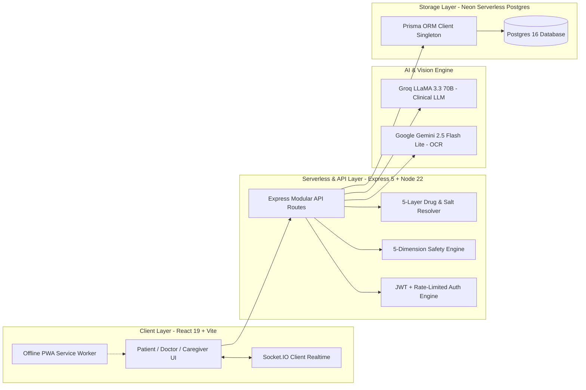

# 🎓 POLYSAFE: Clinical & Technical Exam Revision Handbook & Viva Playbook

> **EXAM & HACKATHON REVISION GUIDE**: This handbook is structured into high-yield exam revision units with exact pitch scripts, key statistics, clinical formulas, and judge viva questions.
>
> 📄 **Instant PDF Available**: A ready-to-print, publication-grade PDF has been generated at [`POLYSAFE_EXAM_STUDY_GUIDE.pdf`](file:///c:/Meet/xyz/PolySafe/POLYSAFE_EXAM_STUDY_GUIDE.pdf).  
> 🌐 **Interactive Printable HTML**: Open [`POLYSAFE_EXAM_STUDY_GUIDE.html`](file:///c:/Meet/xyz/PolySafe/POLYSAFE_EXAM_STUDY_GUIDE.html) in any browser and press `Ctrl + P` &rarr; "Save as PDF".

---

## 📑 Table of Contents
1. [What is PolySafe in 30 Seconds?](#1-what-is-polysafe-in-30-seconds)
2. [The Real Medical Problem (Why PolySafe Exists)](#2-the-real-medical-problem-why-polysafe-exists)
3. [Mathematical Formulations, Formulas & Scoring Logic (Maths First)](#3-mathematical-formulations-formulas--scoring-logic-maths-first)
4. [How PolySafe Solves It (The 5 Safety Subsystems)](#4-how-polysafe-solves-it-the-5-safety-subsystems)
5. [The 3 User Portals & User Journeys](#5-the-3-user-portals--user-journeys)
6. [End-to-End Technical Architecture](#6-end-to-end-technical-architecture)
7. [Live Deployment & Demo Credentials](#7-live-deployment--demo-credentials)
8. [5-Person Team Role Division & Pitch Scripts](#8-5-person-team-role-division--pitch-scripts)
9. [The 5-Minute Flawless Live Demo Walkthrough](#9-the-5-minute-flawless-live-demo-walkthrough)
10. [Judge Q&A Defense Bible (Top 15 Tough Questions & Answers)](#10-judge-qa-defense-bible-top-15-tough-questions--answers)

---

## 1. What is PolySafe in 30 Seconds?

**PolySafe** is an AI-powered clinical polypharmacy safety platform built for **elderly patients, multi-specialist doctors, and family caregivers**. 

When elderly patients take 5, 8, or 10+ medicines from different doctors, normal drug checkers fail because they only check **two drugs at a time in isolation**. 

PolySafe evaluates the **entire cumulative regimen** at once. It detects:
* **Dangerous Drug-Drug Interactions (DDIs)** using a verified database of 222,000+ interactions.
* **Prescribing Cascades** (when a drug's side effect is mistaken for a new illness and another drug is wrongfully added).
* **Hidden Multi-Salt Combinations** in branded Indian medicines (e.g., *Combiflam* hiding Ibuprofen + Paracetamol).
* **Herbal & Dietary Supplement Risks** (e.g., *Ginkgo Biloba* or *Ashwagandha* causing fatal bleeding when taken with *Warfarin*).
* **Anticholinergic Cognitive Burden (ACB)** that causes dementia symptoms, hallucinations, and fall fractures in seniors.
* **Specialist Silos** through a consent-based 6-digit PIN and QR code where doctors can simulate *"What if I prescribe this new drug?"* before giving the patient the prescription.

---

## 2. The Real Medical Problem (Why PolySafe Exists)

### The Statistics Every Teammate Must Know
* **Polypharmacy Definition**: Concurrently taking **5 or more** medications. Hyperpolypharmacy is **10 or more**.
* **Over 30% of emergency hospital admissions** in senior citizens (age 65+) are caused by **Adverse Drug Events (ADEs)**.
* **Over 50% of these admissions are 100% preventable** with continuous cross-regimen screening.

### The 4 Lethal Traps in Modern Healthcare
1. **Siloed Specialists**: 
   A patient visits a Cardiologist for heart issues, an Orthopedic for joint pain, and a Pulmonologist for asthma. Each doctor writes prescriptions in their own clinic without seeing what the other doctors prescribed.
2. **The "Prescribing Cascade" Trap**: 
   A patient takes *Amlodipine* (blood pressure). It causes a common side-effect: swollen ankles. The patient goes to another doctor who thinks it's kidney or heart failure and prescribes *Furosemide* (water pill). Furosemide causes dehydration and gout, so a third doctor prescribes *Allopurinol*. A simple side-effect triggered a chain reaction of 3 unnecessary drugs!
3. **The Indian Multi-Salt Brand Masking Trap**: 
   In India, over 70% of market drugs are **Fixed-Dose Combinations (FDCs)** sold under brand names. A patient taking *Combiflam* for joint pain and *Calpol* for mild fever unknowingly takes a double overdose of Paracetamol (Acetaminophen), risking acute liver failure.
4. **The Herbal & Food Blind Spot**: 
   Patients think Ayurvedic and herbal medicines are "100% natural, so they have zero side-effects". When a patient taking *Warfarin* (blood thinner) drinks green tea extracts, eats grapefruit, or takes *Ginkgo Biloba*, the blood thinning multiplies 5x, leading to spontaneous internal brain hemorrhage.

---

## 3. Mathematical Formulations, Formulas & Scoring Logic (Maths First)

> **CORE PRINCIPLE**: In clinical pharmacology, **deterministic mathematics must always supersede generative heuristics**. Every numerical risk score, visual gauge, and alert banner across PolySafe is derived from validated pharmacokinetic/pharmacodynamic (PK/PD) equations and clinical consensus criteria.

```
[Patient Active Medication List (M₁ ... M_N)]
       │
       ├───► [WHO/NCI 5-Tier Drug Harm Lookup] ────► Mean Risk Formula μ_risk & Max Harm h_max
       ├───► [Anticholinergic Cognitive Burden] ───► TotalACB = ∑ Score(m_i) ∈ {0, 1, 2, 3+}
       ├───► [Bidirectional DDInter Matrix] ───────► (N × (N-1)) / 2 Pairs with Severity Weights W_k
       ├───► [Duplicate Salt Ceiling Engine] ──────► Cumulative Daily Dose > Toxic Threshold
       ├───► [Prescribing Cascade Graph Matching] ─► Directed Loop: Drug_A → Symptom → Drug_B
       └───► [Organ Toxicity Burden Vector] ───────► O_regimen = [Renal, Hepatic, Cardio, CNS]
```

### 3.1 Regimen Cumulative Risk Index Formula (WHO 5-Tier Model)
Let $\mathcal{M} = \{m_1, m_2, \dots, m_N\}$ be the set of $N$ active medications. Each drug $m_i$ has an intrinsic harm level $h_i = \text{HarmLevel}(m_i) \in \{1, 2, 3, 4, 5\}$:
* **Level 1 (Low)**: Vitamins, minerals, probiotics (System default: Green)
* **Level 2 (Mild)**: Metformin, Omeprazole, Atorvastatin (System default: Lime)
* **Level 3 (Moderate)**: Beta-blockers, ACEi, ARBs, SSRIs (System default: Amber)
* **Level 4 (High)**: High-dose NSAIDs, Corticosteroids, Antipsychotics (System default: Orange)
* **Level 5 (Critical)**: Warfarin, Digoxin, Lithium, Methotrexate (System default: Red)

$$\mu_{\text{risk}} = \frac{1}{N} \sum_{i=1}^{N} h_i \quad \text{(Arithmetic Regimen Average)}$$
$$h_{\max} = \max_{1 \le i \le N} (h_i) \quad \text{(Worst-Case Inherent Toxicity)}$$
$$F_{\text{major}} = \big|\{f \in \mathcal{F} \mid \text{Severity}(f) \in \{\text{MAJOR}, \text{CONTRAINDICATED}\}\}\big|$$

#### The Decision Tree Equation:
$$\mathcal{L}_{\text{regimen}} = 
\begin{cases} 
5 \text{ (CRITICAL)}, & \text{if } h_{\max} = 5 \;\lor\; F_{\text{active}} \ge 3 \\
4 \text{ (HIGH)},     & \text{else if } \mu_{\text{risk}} \ge 3.5 \;\lor\; F_{\text{major}} \ge 1 \\
3 \text{ (MODERATE)}, & \text{else if } \mu_{\text{risk}} \ge 2.5 \\
2 \text{ (MILD)},     & \text{else if } \mu_{\text{risk}} \ge 1.5 \\
1 \text{ (LOW)},      & \text{otherwise } (\mu_{\text{risk}} < 1.5)
\end{cases}$$

*Clinical Insight*: If a patient takes even a single Level 5 critical medication (e.g. Warfarin), $h_{\max} = 5$ forces the regimen into **Critical Level 5**, because low-risk vitamins cannot dilute lethal narrow-therapeutic liabilities.

---

### 3.2 Anticholinergic Cognitive Burden (ACB) Summation & Risk Scale
In older adults, exogenous anticholinergic blockade causes acute delirium, memory loss, and a **3x higher risk of falls and fractures**:
$$\text{TotalACB} = \sum_{i=1}^{N} \text{Score}(m_i) \quad \text{where } \text{Score}(m_i) \in \{0, 1, 2, 3\}$$

| Total ACB Score | Risk Level | Clinical Action Required |
|:---:|:---:|:---|
| **0** | **None (Safe)** | Baseline cognitive integrity preserved; no central muscarinic blockade. |
| **1 &ndash; 2** | **Moderate Burden** | Mild sedation; monitor ambulation and daytime drowsiness. |
| **&ge; 3** | **CRITICAL BURDEN** | **Triples risk of delirium, acute confusion, dementia acceleration, and fall fractures.** |

---

### 3.3 DDInter Pairwise Severity Weighting
Given $N$ active medications, the system evaluates all combination pairs:
$$\text{Total Pairs} = \binom{N}{2} = \frac{N(N-1)}{2}$$
Across 222,383 verified clinical pairs in our database, each pair is assigned a deterministic severity weight:
$$W_{\text{Contraindicated}} = 4 \quad > \quad W_{\text{Major}} = 3 \quad > \quad W_{\text{Moderate}} = 2 \quad > \quad W_{\text{Minor}} = 1$$

---

### 3.4 Duplicate Salt Toxicity & Toxic Ceiling Limit
$$\text{Dose}_{\text{cumulative}}(S_k) = \sum_{i \in \text{Products}} \text{Dose}(m_i, S_k) \times \text{DailyFrequency}(m_i)$$
$$\text{Alert Triggered if: } \text{Dose}_{\text{cumulative}}(S_k) > \text{CeilingLimit}(S_k)$$
*Example*: Paracetamol maximum safe adult daily ceiling is **4,000 mg/day** (2,000 mg in cirrhosis/elderly). Taking *Combiflam* (325mg Paracetamol &times; 3/day) + *Calpol 650* (650mg &times; 4/day) = **3,575 mg**, triggering an impending hepatic saturation warning.

---

### 3.5 Prescribing Cascade Directed Graph Traversal
Modeled as a directed temporal graph $G = (V, E)$, where $V = \text{Drugs} \cup \text{Symptoms}$:
$$\text{Cascade Condition: } (m_A \rightarrow s) \in E \;\land\; (s \rightarrow m_B) \in E \;\land\; t(m_A) < t(s) \le t(m_B)$$
*Example*: Amlodipine ($m_A$) prescribed on Day 1 &rarr; Ankle Edema ($s$) logged on Day 20 &rarr; Furosemide ($m_B$) prescribed on Day 25. The correlator detects that $s$ is an adverse reaction of $m_A$, advising the clinician to de-prescribe Amlodipine rather than adding Furosemide.

---

### 3.6 4-System Organ Toxicity Burden Vector
Each medication maps pharmacokinetic clearance strain to a 4-dimensional normalized organ vector:
$$\vec{O}_{\text{regimen}} = \big[ O_{\text{Renal}}, \; O_{\text{Hepatic}}, \; O_{\text{Cardiovascular}}, \; O_{\text{CNS/Cognitive}} \big] \in [0.0, 1.0]^4$$

---

## 4. How PolySafe Solves It (The 5 Safety Subsystems)

```
┌─────────────────────────────────────────────────────────────────────────┐
│                        POLYSAFE CLINICAL CORE                           │
├─────────────────────────────────────────────────────────────────────────┤
│ 1. 5-Layer Indian Multi-Salt Resolver (Trade Name ➔ Active Molecules)  │
│ 2. Deterministic Cumulative Regimen Engine (DDInter 222k+ records)      │
│ 3. Prescribing Cascade Reverse-Timeline Correlator (581 validated pairs)│
│ 4. Anticholinergic Cognitive Burden & Sedation Gauge (Boustani Scale)   │
│ 5. Multi-Modal Intake (Camera Prescription OCR + Pill Imprint + Voice)  │
└─────────────────────────────────────────────────────────────────────────┘
```

### Subsystem 1: 5-Layer Indian Multi-Salt Resolver
When a patient types or scans an Indian trade name, PolySafe breaks it down:
* **Layer 1**: Indian Branded Medicine Knowledge Base (resolves *Augmentin 625* ➔ Amoxicillin 500mg + Clavulanic Acid 125mg; *Zerodol-SP* ➔ Aceclofenac + Paracetamol + Serratiopeptidase).
* **Layer 2**: Direct National Library of Medicine (NLM) RxNorm API lookup for global brand names.
* **Layer 3**: RxNorm Approximate String Matcher (handles spelling mistakes like "Metforrmin").
* **Layer 4**: Curated Botanical & Dietary Supplement Matrix (resolves *Ashwagandha*, *Ginkgo*, *Turmeric*, *St. John's Wort*).
* **Layer 5**: AI Chemical Extraction fallback via Groq LLaMA-3.3-70B with verified salt confirmation.

### Subsystem 2: Deterministic Cumulative Regimen Engine
Instead of just pairing Drug A + Drug B, PolySafe calculates an overall **WHO 5-Tier Cumulative Risk Score**:
* **L1 (Minimal Risk)**: Regimen is balanced with zero known contraindications.
* **L2 (Low Risk)**: Minor monitoring required (e.g., take with meals).
* **L3 (Moderate Risk)**: Moderate interactions present; needs dosage titration.
* **L4 (High Risk)**: Severe interactions or multiple overlapping sedatives; requires clinical intervention.
* **L5 (Critical Risk)**: Dangerous contraindications detected (e.g., Warfarin + Aspirin + Ginkgo), high risk of bleeding, organ toxicity, or sudden cardiac arrest.

### Subsystem 3: Prescribing Cascade Correlator
When a patient logs a symptom (e.g., "my ankles are swollen" or "constant dry cough"), PolySafe:
1. Looks up the patient's existing active drugs and their start dates.
2. Checks against 581 medically documented side-effect triggers (e.g., *Amlodipine* causing ankle edema, *Enalapril/Lisinopril* causing dry cough).
3. If a match is found, it alerts the patient and doctor: *"⚠️ WARNING: Your ankle swelling is very likely a side effect of Amlodipine started 3 weeks ago — do NOT start taking diuretics before your doctor reviews this!"*

### Subsystem 4: Anticholinergic Cognitive Burden (ACB) Gauge
Drugs like *Diphenhydramine* (antihistamine), *Amitriptyline* (nerve pain), and *Oxybutynin* (bladder) block acetylcholine in the brain. 
* In elderly patients, an **ACB Score ≥ 3** triples the risk of confusion, delirium, falls, and early dementia.
* PolySafe calculates the total score live and displays a color-coded gauge (Low, Moderate, High alert).

### Subsystem 5: Multi-Modal Intelligent Intake
Patients do not have to type confusing chemical names:
1. **Prescription Scanner**: Upload or capture a photo of a doctor's handwritten or printed prescription. PolySafe runs a dual vision pipeline (**Gemini 2.5 Flash Lite** + **Tesseract OCR**) to auto-extract medicine names, dosage strengths, and frequencies.
2. **Pill Imprint Identifier**: If a loose pill is found with no box, the patient types the stamp code (e.g., **"L484"**). PolySafe queries the FDA/NLM Pill Imprint database and identifies it as *Acetaminophen 500mg Tablet*.
3. **Voice Input**: Multi-lingual voice search allowing seniors to speak their medicine names.

---

## 4. The 3 User Portals & User Journeys

PolySafe is divided into **three specialized user experiences**:

### 1. The Patient Portal (`/home`, `/timeline`, `/medication-passport`)
* **Live Safety Ring & Status**: Big, bold indicator showing if the current combination is SAFE (green), CAUTION (amber), or CRITICAL (red).
* **Daily Regimen Timetable**: Visual morning, noon, evening, and bedtime dose schedule with checkboxes that log adherence.
* **Food & Herb Spacing Alerts**: Clearly tells the patient: *"Do NOT take Calcium with Levothyroxine (separate by 4 hours)"* or *"Avoid grapefruit juice while taking Atorvastatin"*.
* **Emergency Medical Passport**: Generates a fast, downloadable, printable emergency medical summary containing current drugs, allergies, age, emergency contact, and QR code for EMTs and ER staff.
* **Accessibility**: Instant toggle for **English, Hindi, and Gujarati**, Dark/Light mode, and a high-contrast **Projector Mode** designed for hospital monitors and presentations.

### 2. The Doctor Portal (`/doctor-dashboard`, `/doctor-share`)
* **Instant Silent Connection**: The patient clicks "Share with Doctor" and receives a **6-Digit PIN** or **QR Code**. The doctor inputs the PIN on their dashboard and instantly gains real-time view of the patient's full regimen.
* **Prescriber Swimlanes**: Visually categorizes who prescribed what (Dr. Patel = Heart; Dr. Sharma = Orthopedic; Over-The-Counter = Patient).
* **Pre-Prescription "What-If" Simulator**: Before writing a new prescription, the doctor types a proposed drug (e.g., *Ibuprofen 400mg*). The system simulates the addition in real time, warning the doctor if it clashes with the patient's existing drugs or conditions before the prescription is even signed!
* **Clinical Directives**: Doctor can send a direct medication instruction (e.g., "Discontinue Aspirin immediately; switch to Paracetamol").

### 3. The Caregiver Portal (`/caregiver`)
* **Privacy-Safe View**: Caregivers (sons, daughters, nurses) can monitor medication adherence without accessing private medical diagnoses that patients might want to keep confidential.
* **Dose Adherence & Streak Tracker**: Real-time log of taken vs. missed doses.
* **Automated Reminders**: Trigger instant reminder notifications or SMS alerts when a high-risk medication is overdue.

---

## 5. End-to-End Technical Architecture



### Key Technical Specs
* **Frontend**: React 19, Vite 8, TailwindCSS, Framer Motion, Lucide React, Axios (with 25s serverless-resilient timeout), Canvas Confetti, QR Code Generator.
* **Backend**: Node.js 22, Express 5, Prisma ORM 5.22, Socket.IO 4.8.
* **Database**: Neon Serverless Postgres (multi-region with auto-scaling connection pooling).
* **AI & Machine Learning**: 
  * Groq LLaMA-3.3-70B for real-time natural language clinical and layman explanations.
  * Google Gemini 2.5 Flash Lite for multi-line handwriting and printed prescription vision OCR.
* **Verified Datasets Loaded in Engine**:
  * `DDInter`: 222,383 interaction pairs.
  * `Boustani ACB Scale`: 567 calibrated drug anticholinergic scores.
  * `Prescribing Cascades`: 581 validated drug-symptom rules.
  * `Herb-Drug Interactions`: 526 clinical monographs.
  * `FDA OFFSIDES`: 1.2M adverse event safety signals.
  * `FDA/NLM Pill Imprints`: 560 verified markings.

---

## 6. Live Deployment & Demo Credentials

| Resource | URL / Details | Status |
|---|---|---|
| **Live Frontend App** | [https://poly-safe.vercel.app](https://poly-safe.vercel.app) | 🟢 Live (200 OK) |
| **Live Backend API** | [https://polysafe-backend.vercel.app](https://polysafe-backend.vercel.app) | 🟢 Live (200 OK) |
| **API Health Check** | [https://polysafe-backend.vercel.app/health](https://polysafe-backend.vercel.app/health) | `{"status":"ok","db":true}` |
| **GitHub Repository** | [https://github.com/meetchauhan17/PolySafe](https://github.com/meetchauhan17/PolySafe) | Public / Main |

### Demo Accounts for Live Pitch
Both accounts are pre-seeded with rich clinical demo data on the live Neon Postgres database:

1. **Patient Demo Account**:
   * **Email**: `meetc8030@gmail.com`
   * **Password**: `Meet@123`
   * *Profile*: 68-year-old senior with Hypertension and Atrial Fibrillation, taking Warfarin, Aspirin, and Ginkgo Biloba (triggers Critical Risk alert).
2. **Doctor Demo Account**:
   * **Email**: `cse.230840131016@gmail.com`
   * **Password**: `Meet@123`
   * *Profile*: Dr. Sarah Wilson, Senior Cardiologist (Reg: `MED-89412`).

---

## 7. 5-Person Team Role Division & Pitch Scripts

When pitching to hackathon judges, **never talk over each other**. Each person owns a distinct, impressive domain. Here is the exact role breakdown:

```
┌────────────────────────────────────────────────────────────────────────┐
│                   5-PERSON PRESENTATION ROLES                          │
├────────────────────────────────────────────────────────────────────────┤
│ Person 1: Team Lead — Problem Statement, Clinical Impact & Vision      │
│ Person 2: Frontend & UX Specialist — Accessibility, PWA & Patient Demo │
│ Person 3: Pharmacological Engine Architect — Multi-Salt & Safety Logic │
│ Person 4: AI & Computer Vision Lead — Prescription OCR & LLM Explainer │
│ Person 5: Doctor Portal & Cloud DevOps — Security, Sync & Architecture │
└────────────────────────────────────────────────────────────────────────┘
```

---

### 👤 Person 1: Team Lead (Problem, Clinical Urgency & Opening Hook)
* **Responsibility**: Introduces the team, grabs the judges' attention with staggering clinical facts, and frames PolySafe's mission.
* **Speaking Script**:
  > *"Respected judges, imagine your 70-year-old grandfather visits a cardiologist for his heart, an orthopedic for his knee pain, and drinks an herbal tea for vitality. Each doctor prescribes safe medicines. Yet three weeks later, he collapses in the bathroom with severe internal bleeding. Why? Because in modern healthcare, doctors prescribe in silos. Conventional drug checkers only test two drugs at a time. They completely miss the silent killer: **Polypharmacy Risk**. Over 30% of emergency hospital admissions in elderly patients are caused by adverse drug interactions, and more than half are 100% preventable. We built **PolySafe**—the world’s first continuous, whole-regimen clinical intelligence platform that protects seniors, connects specialists, and empowers family caregivers. Let’s show you how it works live."*
* **Key Numbers to Memorize**: 30% of elderly hospitalizations; 5+ drugs is polypharmacy; 50%+ are preventable; 222,000+ verified DDInter interaction records.

---

### 👤 Person 2: Frontend & Accessibility Engineer (Patient Experience)
* **Responsibility**: Drives the live screen on the Patient Portal; demonstrates design excellence, multi-language support, PWA offline resilience, and the Emergency Passport.
* **Speaking Script**:
  > *"I designed the patient experience. Elderly patients cannot use complicated medical apps. PolySafe features a clean, high-contrast, accessible interface designed around one central question: **'Am I safe today?'** The top status ring immediately displays our WHO 5-Tier cumulative risk score. Below, our smart timetable organizes medicines into morning, afternoon, evening, and night slots with one-touch dose logging. To overcome language barriers in diverse regions, PolySafe natively supports **English, Hindi, and Gujarati** with full medical term localization. We also implemented an offline Progressive Web App (PWA) with service workers, so if a patient loses internet in a rural clinic or basement pharmacy, their drug safety list and emergency medical passport remain 100% accessible."*
* **Screen Actions**: Show the homepage status ring, click the language switcher to Gujarati/Hindi, toggle Projector Mode, click the "Emergency Medical Passport" modal to show the print-ready medical badge.

---

### 👤 Person 3: Pharmacological Engine Architect (Multi-Salt & Safety Core)
* **Responsibility**: Explains the deep medical logic, Indian branded medicine resolver, Prescribing Cascade engine, and ACB calculation.
* **Speaking Script**:
  > *"Behind the UI is our deterministic 5-dimension pharmacological engine. When an Indian patient adds a popular medicine like **Combiflam** or **Augmentin 625**, generic apps fail because they look for that exact brand name in US databases. PolySafe’s **5-Layer Formulation Resolver** deconstructs branded trade names into pure active chemical molecules—identifying that Combiflam contains both Ibuprofen 400mg and Paracetamol 325mg, preventing toxic double-dosing. Furthermore, we built a **Prescribing Cascade Correlator** backed by 581 clinical rules. If a patient logs swollen ankles, PolySafe doesn't just treat the symptom; it cross-references the onset date with their blood pressure drug Amlodipine to stop dangerous duplicate prescriptions before they start. Finally, our Boustani scale gauge calculates cumulative Anticholinergic Cognitive Burden to prevent drug-induced delirium and fall fractures."*
* **Screen Actions**: Add a medicine like "Combiflam" or "Ginkgo Biloba", show how it decomposes into active ingredients, show the ACB gauge meter moving.

---

### 👤 Person 4: AI & Computer Vision Lead (OCR, Pill Imprint & Explanations)
* **Responsibility**: Demonstrates how prescriptions and unknown pills enter the system, and how Groq LLaMA translates medical jargon into plain human language.
* **Speaking Script**:
  > *"Many seniors cannot type long medication names. To make onboarding effortless, we built a multi-modal intake pipeline. Patients can take a photo of their physical prescription. Our dual-vision engine combines **Google Gemini 2.5 Flash Lite** for deep contextual handwriting understanding with **Tesseract OCR** as an offline fallback to extract drug names, strengths, and dosage frequencies in seconds. If a patient finds a loose pill on their nightstand, our **Pill Imprint Identifier** lets them enter the stamped code—such as 'L484'—to instantly identify Acetaminophen 500mg. To ensure patients actually understand their risks, we run **Groq LLaMA-3.3-70B** to generate dual explanations: a rigorous clinical monograph for doctors, and a warm, clear 6th-grade reading level explanation for the patient."*
* **Screen Actions**: Show the prescription scan upload dropzone, open Pill Imprint and search `L484`, open an interaction flag to show the clinical vs. plain explanation tabs.

---

### 👤 Person 5: Doctor Portal, Security & Cloud DevOps (Infrastructure & Sync)
* **Responsibility**: Demonstrates the Doctor Portal, the real-time 6-digit sync, pre-prescription simulator, and the production cloud deployment.
* **Speaking Script**:
  > *"The biggest failure in polypharmacy is specialist silos. PolySafe bridges this gap with zero friction. The patient generates a secure 6-digit PIN or QR code. The doctor enters it into their dashboard and instantly views the patient's unified prescriber swimlane. Most importantly, before writing a new prescription, the doctor uses our **Pre-Prescription 'What-If' Safety Simulator**. If Dr. Wilson wants to prescribe Ibuprofen, she types it into the simulator. PolySafe instantly computes the projected impact on the patient's existing regimen, warning her of bleeding risks with Warfarin before the prescription is ever printed. Our entire backend is live on **Node 22 and Vercel serverless**, connected to a **Neon Serverless Postgres** database with connection pooling, strict rate limiting, and an automated 18-step verification audit that ensures 100% test passing."*
* **Screen Actions**: Open the Doctor Dashboard on another window, show the Pre-Prescription safety checker with "Ibuprofen", show the live API health check endpoint returning `status: "ok"`.

---

## 8. The 5-Minute Flawless Live Demo Walkthrough

Follow this exact minute-by-minute timeline during the judging round:

* **0:00 - 0:45 (Hook & Problem)**: Person 1 explains the 30% hospitalization stat and why pairwise checking fails.
* **0:45 - 1:45 (Patient Dashboard)**: Person 2 displays the live Patient Portal at [https://poly-safe.vercel.app](https://poly-safe.vercel.app), logs in as `meetc8030@gmail.com`, shows the **Critical Risk Level 5** ring caused by Warfarin + Aspirin + Ginkgo Biloba. Toggles English to Hindi/Gujarati to wow judges with accessibility.
* **1:45 - 2:45 (Indian Salt Resolver & Prescribing Cascade)**: Person 3 shows how the system decomposed Indian brands, shows the Prescribing Cascade alert on swollen ankles linked to Amlodipine, and points out the Anticholinergic cognitive load score.
* **2:45 - 3:45 (Vision Scan & AI Explanations)**: Person 4 opens the Prescription Scan tab, shows the pill imprint search for `L484` (Acetaminophen), and shows the Groq AI-generated plain-English explanation.
* **3:45 - 4:30 (Doctor Portal & Pre-Prescription Simulator)**: Person 5 switches to the Doctor Dashboard, runs the "What-If" check on *Ibuprofen*, showing how the simulator protects the patient before the doctor writes the drug.
* **4:30 - 5:00 (Architecture, Testing & Wrap-Up)**: Person 1 closes with: *"PolySafe has passed an exhaustive 18-step automated clinical audit, is deployed live on Vercel and Neon Postgres, and is ready to save lives today. Thank you!"*

---

## 9. Judge Q&A Defense Bible (Top 15 Tough Questions & Answers)

### Q1: "How is PolySafe different from 1mg, Practo, or WebMD Drug Interaction Checkers?"
* **Answer**: *"Existing commercial apps like 1mg or WebMD are **pairwise, static, and consumer-focused**. If you input 6 drugs, they show you 15 confusing pairwise popups with no prioritization. They completely miss **cumulative toxicity** (e.g., 3 mild sedatives adding up to severe respiratory depression), they don't calculate **Anticholinergic Cognitive Burden (ACB)** for elderly dementia risks, they don't have a **Prescribing Cascade correlator** linking symptoms to drugs, and they do not provide a **Doctor Pre-Prescription Simulator** connecting multiple treating specialists."*

### Q2: "What if the prescription OCR misreads handwriting and adds the wrong medicine?"
* **Answer**: *"We never blindly write OCR output into the database. PolySafe implements a **Human-in-the-Loop Verification Pipeline**. When Gemini Vision and Tesseract scan a prescription, extracted drugs are staged in an interactive review card with confidence badges. The patient or pharmacist must review, confirm, or edit the dosage before it is officially committed to the active regimen."*

### Q3: "Aren't LLMs prone to medical hallucinations? How can doctors trust the AI?"
* **Answer**: *"Our safety engine is **100% deterministic, not generative**. All drug interactions are validated against our hard-coded **DDInter database of 222,000+ clinical records**, the NLM RxNorm registry, and validated clinical cascades. The LLM (Groq LLaMA-3.3-70B) is strictly used as an **explanation synthesizer** to translate hard scientific data into patient-friendly language. The medical facts and severity tiers are calculated by mathematical algorithms, not generative AI."*

### Q4: "How does PolySafe handle Indian Fixed-Dose Combinations (FDCs)?"
* **Answer**: *"Through our **5-Layer Indian Formulation Resolver**. Branded medicines like Combiflam, Pan-D, or Zerodol-SP are mapped in our curated multi-salt ontology. We decompose them into active chemical salts (e.g. Aceclofenac + Paracetamol) and check interactions on the molecular constituent level rather than the brand level."*

### Q5: "How do you protect patient privacy between doctors and caregivers?"
* **Answer**: *"We enforce strict **Role-Based Access Control (RBAC)**. Caregivers only receive a simplified adherence view (taken vs. missed doses and reminder alerts); they cannot view sensitive medical diagnoses or doctor clinical notes. Furthermore, doctor access is **consent-based and ephemeral** via a time-limited 6-digit PIN and QR code that the patient must explicitly authorize."*

### Q6: "Can this platform work in rural areas with poor internet connectivity?"
* **Answer**: *"Yes. PolySafe is built as an installable **Progressive Web App (PWA)** with service worker caching. The core medicine schedule, local emergency medical card, and offline fallback databases remain accessible even when the device is completely disconnected from the internet."*

### Q7: "What happens if a patient takes herbal supplements or Ayurvedic medicines?"
* **Answer**: *"Over 60% of patients never disclose herbal remedies to their doctors. PolySafe treats botanical supplements as first-class medications. We have built an explicit **Herb-Drug Interaction Matrix of 526 clinical monographs** (covering Ashwagandha, Ginkgo Biloba, St. John's Wort, Curcumin, etc.) that alerts patients if a supplement alters cytochrome P450 enzyme metabolism or multiplies bleeding risks."*

### Q8: "What is an Anticholinergic Cognitive Burden (ACB) and why is it important?"
* **Answer**: *"Many common elderly medications (for allergies, sleep, bladder, nerve pain) block acetylcholine. When multiple low-scoring drugs are taken concurrently, their cumulative anticholinergic load crosses a threshold score of 3, leading to confusion, memory loss, hallucinations, and a 3x higher rate of falls. PolySafe runs the validated **Boustani ACB scale** to detect this cumulative toxicity."*

### Q9: "What is a 'Prescribing Cascade' and how do you detect it?"
* **Answer**: *"A prescribing cascade occurs when an adverse drug reaction is misdiagnosed as a new medical condition, prompting an unnecessary second prescription (e.g., Amlodipine causes leg swelling ➔ Doctor prescribes Furosemide). PolySafe tracks the chronological timeline of when each drug was started and compares newly reported patient symptoms against 581 known drug side-effect profiles to flag potential cascades."*

### Q10: "What database and infrastructure powers PolySafe?"
* **Answer**: *"We use **Neon Serverless Postgres** connected via **Prisma ORM**, deployed alongside **Node.js 22 / Express 5 on Vercel Serverless**. This gives us instant serverless auto-scaling, automated connection pooling, zero-idle cost, and production database branching."*

### Q11: "How do you prevent brute-force attacks and abuse on the auth endpoints?"
* **Answer**: *"We implement three layers of security: (1) IP-level rate limiting (50 login attempts per 15 min), (2) Email-specific OTP rate limits (5 OTP requests per hour), and (3) Per-account temporary lockouts after 5 consecutive failed attempts, alongside timing-attack-safe bcrypt verification."*

### Q12: "How do you verify the system works end-to-end?"
* **Answer**: *"We maintain a continuous **18-Step Automated System Audit** (`npm test`) that programmatically simulates full patient and doctor lifecycles: user signup, OTP verification, drug addition, DDInter interaction triggering, pill imprint identification, cascade detection, doctor QR pairing, pre-prescription safety simulation, and soft-deletion. All 18 steps pass with 100% success."*

### Q13: "What happens in an emergency if an EMT or ER doctor needs the patient's data?"
* **Answer**: *"PolySafe includes a one-click **Emergency Medical Passport**. It displays current medications, severe allergies, blood group, emergency contacts, and an instant scannable QR code formatted for quick clinical triage on any mobile browser."*

### Q14: "Can a doctor override a warning if they believe the clinical benefit outweighs the risk?"
* **Answer**: *"Yes. PolySafe is a **Clinical Decision Support System (CDSS)**, not a blocker. If an oncologist or cardiologist intentionally combines two interacting drugs under tight clinical monitoring, the doctor can acknowledge the warning and document clinical justification."*

### Q15: "What is your future roadmap for PolySafe?"
* **Answer**: *"Our next phases include: (1) FHIR/HL7 integration for direct sync with hospital Electronic Health Record (EHR) systems like Epic and Cerner, (2) Wearable integration with Apple Health and Google Fit to correlate drug ingestion with live vitals (heart rate, blood pressure, sleep stages), and (3) Pharmacogenomic (PGx) profiling to flag genetic drug metabolism variations."*

---

## 🏆 Final Pitch Reminder for the Whole Team
1. **Be Enthusiastic**: Judges see 20+ projects a day. Your energy, medical empathy, and clarity will make you stand out.
2. **Stick to Your Role**: Keep your speaking time within your allocated 45–60 seconds.
3. **Show, Don't Just Tell**: Keep the live deployed app visible on screen with real interactions.
4. **Trust the Facts**: You have 222,000+ interaction records, 581 cascades, 567 ACB scores, and an 18/18 verified audit backing you up!
