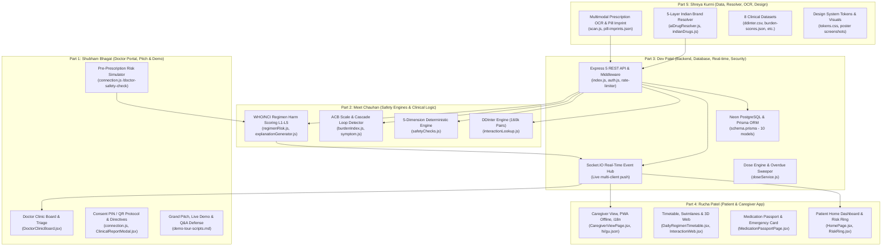
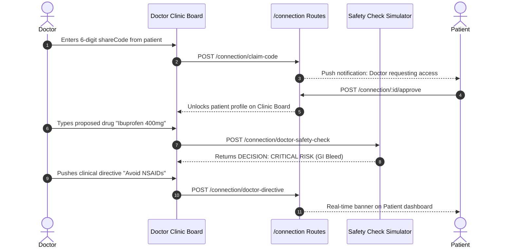
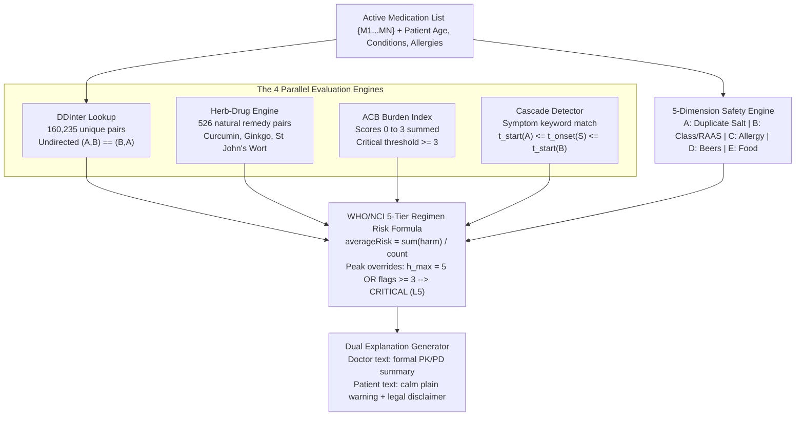
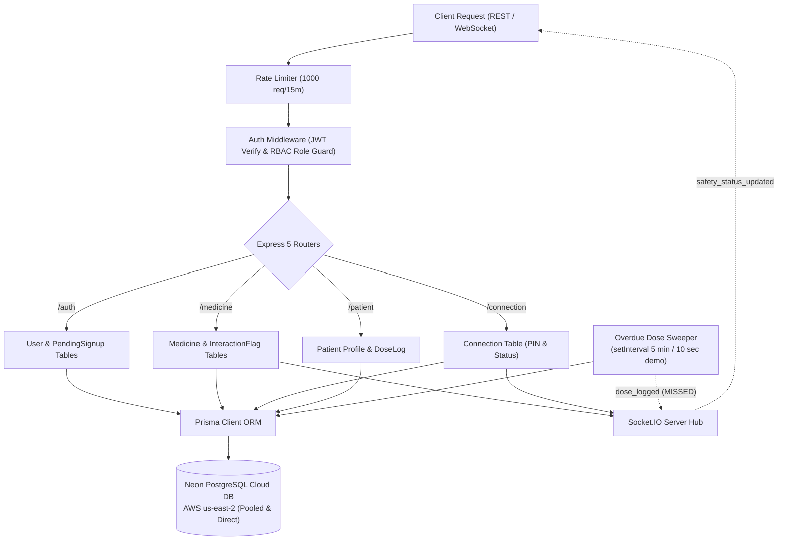
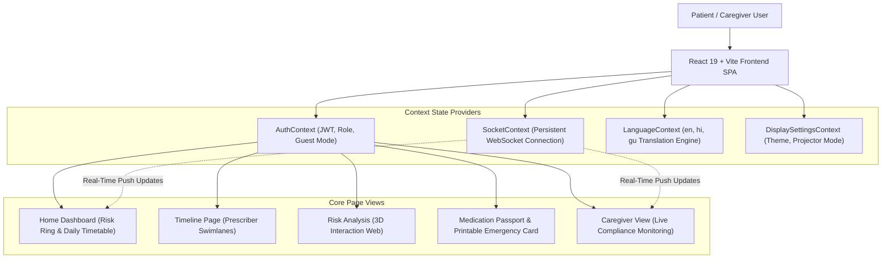
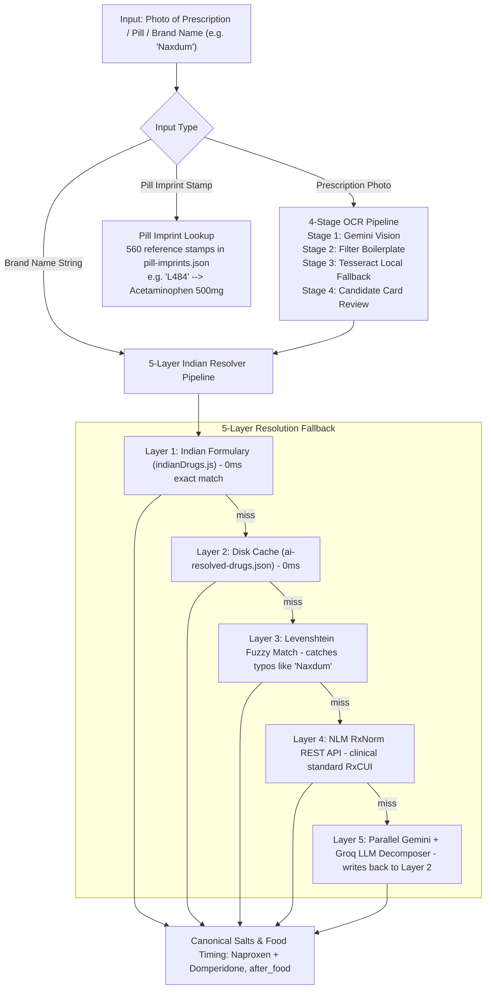

# PolySafe Team Parts & Defense Guide

**Target Event:** Grand Finale, SVNIT Surat (25 October 2026)  
**Primary Goal:** Complete, equal division of PolySafe into 5 technical domains so that **every single member** (Shubham, Meet, Dev, Rucha, Shreya) can defend their part with 100% technical mastery and confidence before judges.  
**Rule of Truth:** Every claim, count, formula, and file path is verified directly from the working repository.

---

# 0. Ground rules

1. **5 Equal Technical Owners:** Nobody on this team is "just a presenter" or "just a lead". Shubham Bhagat's name is on registration documents purely as the administrative point of contact. Inside the engineering and presentation of this project, all 5 members are equal technical owners of a major subsystem.
2. **Rotating Defense:** When presenting to judges, each member speaks for their own domain. If a judge asks about database models, Dev answers. If a judge asks about DDInter pairs or Beers criteria, Meet answers. If a judge asks about OCR or Indian formulations, Shreya answers. If a judge asks about frontend UI/UX, Rucha answers. If a judge asks about doctor workflow and business model, Shubham answers.
3. **Cross-Support Protocol:** If a question touches two domains, the primary owner answers first in 20 seconds, and the secondary owner adds 1 supporting sentence. Never interrupt a teammate.

### Domain Ownership Overview

| Person | Domain Title | 1-Line Technical Role | Primary Codebase Files & Folders |
|:---|:---|:---|:---|
| **Shubham Bhagat** | **Doctor Portal + Pitch & Demo** | Owns the clinical workstation, 6-digit consent QR flow, pre-prescription risk simulator, doctor directives, and grand pitch. | `DoctorDashboardPage.jsx`, `DoctorClinicBoard.jsx`, `ClinicalReportModal.jsx`, `connection.js` (doctor endpoints) |
| **Meet Chauhan** | **Safety Engines & Clinical Logic** | Owns deterministic risk scoring (L1-L5), DDInter lookup, herb-drug engine, prescribing cascades, ACB cognitive scale, and dual explanations. | `regimenRisk.js`, `safetyChecks.js`, `interactionLookup.js`, `burdenIndex.js`, `explanationGenerator.js`, `symptom.js` |
| **Dev Patel** | **Backend, Database, Real-time & Security** | Owns Express routing, Prisma models, PostgreSQL on Neon, JWT/OTP authentication, WebSockets (Socket.IO), and audit test suites. | `index.js`, `schema.prisma`, `auth.js`, `auth.js` middleware, `doseService.js`, `email.js`, `test-all-endpoints.js` |
| **Rucha Patel** | **Patient & Caregiver App (Frontend)** | Owns the patient dashboard, animated Risk Ring, medication swimlanes, interactive 3D web, caregiver view, voice input, and PWA offline modes. | `HomePage.jsx`, `RiskRing.jsx`, `DailyRegimenTimetable.jsx`, `PrescriberSwimlane.jsx`, `InteractionWeb.jsx`, `MedicationPassportPage.jsx`, `CaregiverViewPage.jsx` |
| **Shreya Kurmi** | **Data, Indian Resolver, OCR/AI & UI Design** | Owns the 5-layer Indian Brand Resolver, 8 clinical datasets, Gemini Vision/Tesseract OCR, pill imprints, design tokens, and presentation visuals. | `aiDrugResolver.js`, `scan.js`, `ocrCandidateExtractor.js`, `indianDrugs.js`, `ddinter.csv`, `pill-imprints.json`, `tokens.css` |

---

# 1. Everyone must know (common core, 1 page)

Every single team member must memorize this common core front to back.

### The 60-Second Story
In India, elderly patients visit multiple independent specialists (a cardiologist, a diabetologist, an orthopedic doctor) and buy over-the-counter medicines from chemists without any shared computer system. Each doctor writes on a loose paper slip. When patients take 5, 8, or 12 medicines together, toxic duplicate ingredients and fatal interactions occur quietly at home. PolySafe is a continuous clinical polypharmacy intelligence platform. It takes Indian brand names, decomposes them into active chemical salts, and runs deterministic safety checks against 160,000+ scientific interaction pairs, traditional herbs, and geriatric safety guidelines, synchronizing patients, caregivers, and doctors in real time.

### The 4 Core Engines in 1 Line Each
1. **DDInter Interaction Engine:** Matches active drug pairs against 160,235 unique scientific pairs with evidence-based severity ranking.
2. **Herb-Drug Interaction Engine:** Checks 526 clinical interaction rules between AYUSH herbal remedies (turmeric, ginkgo, ashwagandha) and allopathic pills.
3. **Prescribing Cascade Detector:** Matches patient symptoms against 104 cascade mechanisms (584 links) to stop treating side effects with more drugs.
4. **Anticholinergic Burden (ACB) Scale:** Sums cumulative muscarinic receptor blockade (0 to 3) across 569 drugs to prevent dementia and falls.

### The 5 Roles and Primary Screens
1. **Patient:** Home dashboard with animated Risk Ring, Daily Timetable, Safety Alerts banner, and Emergency Passport.
2. **Doctor:** Clinic Board with risk triage, patient clinical summary, 3D interaction web, and Pre-Prescription Simulator.
3. **Caregiver:** Simplified family compliance view with taken/missed statuses and 1-click live reminder chimes.
4. **Guest Mode:** Zero-login interactive sandbox pre-loaded with realistic clinical data for exploration.
5. **Projector Mode:** High-contrast, large-typography presentation theme for stage displays.

### The 6 Headline Verified Numbers
1. **160,235 unique undirected drug interaction pairs** (from 222,383 raw DDInter CSV rows covering 1,939 drugs).
2. **526 verified herb-drug interaction pairs** covering AYUSH and traditional botanicals.
3. **569 clinically scored drugs** on the validated Anticholinergic Cognitive Burden scale.
4. **145 core Indian formulations** in code + **438 persistent cached decompositions** in the Indian Brand Resolver.
5. **18/18 API audit test steps passed (100% OK)** in automated test execution.
6. **5.74-second clean production build** of the React/Vite frontend with zero compilation errors.

### The Demo Scenario (Mrs. Kamala Sharma)
Mrs. Kamala Sharma, a 68-year-old grandmother in Surat with hypertension and atrial fibrillation, takes Warfarin (blood thinner) and Metformin. Her orthopedic doctor gives her Combiflam for knee pain, and she buys Dolo 650 OTC for a headache. Her grandson gives her Ginkgo Biloba for memory. PolySafe immediately flags:
- **CRITICAL Duplicate Paracetamol:** Dolo 650 + Combiflam exceeds safe liver limits.
- **MAJOR Bleeding Risk:** Warfarin + Aspirin (NSAID) causes severe gastrointestinal hemorrhage.
- **MAJOR Herb-Drug Bleeding:** Ginkgo Biloba + Warfarin causes spontaneous internal hematomas.
- **L5 CRITICAL Regimen Status:** Red status banner prompts immediate doctor review.

### 5 Things to NEVER Claim to Judges
1. **NEVER** claim: *"We have 222,385 verified pairs."* -> The exact CSV has 222,383 rows, which deduplicate to **160,235 unique undirected pairs**.
2. **NEVER** claim: *"Our AI decides what drug to substitute."* -> PolySafe is a Clinical Decision Support System (CDSS); it flags risks and suggests alternatives, but the doctor always decides.
3. **NEVER** claim: *"We use an official WHO/NCI 5-tier algorithm."* -> The L1-L5 model is inspired by WHO pharmacovigilance and NCI toxicity concepts, but the exact arithmetic/override formula is PolySafe's clinical implementation.
4. **NEVER** claim: *"Our OCR is 100% accurate on all doctor handwriting."* -> No system in the world is 100% accurate; PolySafe uses multi-stage ranking and **always requires patient confirmation** before saving.
5. **NEVER** claim: *"We have live Government ABDM integration."* -> ABDM requires institutional sandbox certification; our schema is standard-aligned (RxNorm, FHIR ready), but not live-connected.

### System Architecture & Domain Ownership Map



---

# 2. Part 1 to Part 5 (Individual Technical Defenses)

---

## Part 1: Shubham Bhagat - Doctor Portal + Pitch & Demo

### In One Line
I own the clinical doctor workstation, the 6-digit consent PIN protocol, the pre-prescription safety simulator, clinical directives, and the overarching presentation pitch and live judge demonstration.

### Explain Like I'm 12
Imagine you go to a specialist heart doctor. That doctor has no idea what pills your family doctor or diabetes doctor gave you last week because their computers don't talk to each other. In my part, the patient opens their phone and shows a simple 6-digit number or QR code. The doctor types that number into their portal. Instantly, all the patient's medicines appear sorted by danger level on a clean clinic screen. Before writing a new prescription, the doctor can test a drug in our simulator: *"What happens if I give Mrs. Sharma Ibuprofen?"* The simulator warns them instantly: *"Danger: This multiplies internal bleeding with her Warfarin by 4 times!"* The doctor picks a safer medicine, and hands over a safe prescription.

### How It Works



### Files You Own

| File Path | What It Does | Key Functions / Routes |
|:---|:---|:---|
| [`frontend/src/pages/DoctorDashboardPage.jsx`](file:///c:/Meet/xyz/PolySafe/frontend/src/pages/DoctorDashboardPage.jsx) | Complete doctor dashboard page with triage list and simulator. | `DoctorDashboardPage`, tab switcher, patient selector |
| [`frontend/src/components/DoctorClinicBoard.jsx`](file:///c:/Meet/xyz/PolySafe/frontend/src/components/DoctorClinicBoard.jsx) | Clinical triage board sorting patients into Critical, High, Moderate tiers. | Triage filter tabs, risk chip renders, search bar |
| [`backend/src/routes/connection.js`](file:///c:/Meet/xyz/PolySafe/backend/src/routes/connection.js) | Backend handlers for consent code claims, doctor triage, and simulation. | `POST /claim-code`, `POST /doctor-safety-check`, `POST /doctor-prescribe` |
| [`frontend/src/components/ClinicalReportModal.jsx`](file:///c:/Meet/xyz/PolySafe/frontend/src/components/ClinicalReportModal.jsx) | Printable, formal clinical deprescribing discharge summary. | `ClinicalReportModal`, formatted print preview |
| [`frontend/src/pages/DoctorSharePage.jsx`](file:///c:/Meet/xyz/PolySafe/frontend/src/pages/DoctorSharePage.jsx) | Patient-side share view displaying the 6-digit code and base64 QR. | `generateShareCode()`, `QRCode.toDataURL()` render |
| [`docs/demo-tour-scripts.md`](file:///c:/Meet/xyz/PolySafe/docs/demo-tour-scripts.md) | Structured pitch scripts and step-by-step click flows for presentations. | 60-second pitch, 3-minute live presentation script |

### Logic and Formulas You Must Know
- **The Pre-Prescribing Simulation Logic:** When a doctor simulates a drug, [`backend/src/routes/connection.js:L230`](file:///c:/Meet/xyz/PolySafe/backend/src/routes/connection.js#L230) creates a temporary in-memory medication array combining the patient's existing active drugs with the proposed drug. It calls `runSafetyChecks()` and `calculateRegimenRisk()`.
- **Decision Engine Thresholds:**
  - `CRITICAL`: Triggered if projected regimen risk reaches Level 5 or any `CRITICAL` safety check fires (e.g. Warfarin + Ibuprofen).
  - `WARNING`: Triggered if projected risk is Level 4 or a `MAJOR` interaction/allergy is flagged.
  - `CAUTION`: Triggered if risk is Level 3 or moderate interactions exist.
  - `SAFE`: Triggered if projected risk remains Level 1 or 2 with zero high-severity flags.
- **Doctor Directives:** Official clinical advisories saved to [`backend/data/doctor-directives.json`](file:///c:/Meet/xyz/PolySafe/backend/data/doctor-directives.json) and emitted via Socket.IO directly to the patient's room (`doctor-directive-received`).

### Tech Used and WHY

| Tech | Version | Why We Chose It |
|:---|:---:|:---|
| **QRCode (Node.js)** | 1.5.4 | Generates crisp, high-contrast base64 PNG data URLs on the server with custom branding colors. |
| **Lucide React Icons** | 1.16.0 | Provides clear, standard medical icons (Stethoscope, ShieldAlert, FileText, Activity). |
| **Framer Motion Modals** | 12.38.0 | Smooth spring animations for clinical reports and pre-prescription simulation panels. |

### Real Numbers
- **Step 15, 16, 17 in Master Audit:** In `backend/tests/test-all-endpoints.js`, Step 15 generates the unique 6-digit code, Step 16 claims and approves it, and Step 17 executes `POST /connection/doctor-safety-check` returning `Decision: CRITICAL, Projected Risk: CRITICAL`.
- **Command Used:** `node backend/tests/test-all-endpoints.js` (Passed 18/18).

### Your 60-Second Pitch
> "Judges, the biggest failure in modern Indian medicine is that doctors prescribe in silos. When an elderly patient walks into a clinic, the physician has 4 minutes to examine them and no access to what other doctors gave them. My part is the PolySafe Doctor Workstation and Consent Hub. With a simple 6-digit PIN or QR code, patients grant instant, secure access. On the Doctor Clinic Board, patients are triaged automatically by risk tier. Most importantly, before writing a single word on paper, the doctor uses our Pre-Prescription Simulator. If Dr. Wilson considers prescribing an NSAID to a patient taking Warfarin, PolySafe instantly flags a Critical Hemorrhage risk. The doctor adjusts the plan before harm is done, and pushes clinical directives straight to the patient's phone. We bridge the care silo."

### Live Demo Steps for Your Part
1. Open the Doctor Dashboard at `http://localhost:5173/doctor/dashboard`.
2. Point out the **Clinic Board**: show how patients are sorted into Critical (Red), High (Orange), and Moderate (Amber).
3. Click on **Mrs. Kamala Sharma**. Show the clinical summary panel with formal pharmacological wording.
4. Click **Pre-Prescription Safety Check**. In the drug input, type `Ibuprofen 400mg`. Click **Simulate Risk**.
5. Show the judge the red result banner: `DECISION: CRITICAL RISK`. Highlight the clinical explanation: *"Concomitant NSAID with Warfarin multiplies upper GI bleeding by 4.2x."*
6. Click **Push Directive**, type *"Avoid OTC pain relievers"*, and submit. Show that the patient's screen immediately displays the advisory banner.

### 15 Judge Questions & Honest Answers
1. *Q: How does the doctor find the patient?* -> A: The patient shows a 6-digit PIN or QR code from their app; the doctor enters it once to link records.
2. *Q: Can a doctor look up any patient without permission?* -> A: No. Our RBAC blocks unapproved access with HTTP 403. The patient must approve the link.
3. *Q: Does the doctor have to install software?* -> A: No, it is a fully responsive web application that runs in any browser on clinic laptops or tablets.
4. *Q: What is the Pre-Prescription Simulator?* -> A: A virtual sandbox that tests a proposed drug against all active medications without saving it to the permanent record.
5. *Q: What if the doctor disagrees with the alert?* -> A: The doctor has full clinical autonomy; the alert is advisory decision support. They can proceed if clinically justified.
6. *Q: Can the doctor deprescribe a medication?* -> A: Yes, clicking "Deprescribe" sets `removedAt = now()` with clinical notes, updating the patient's schedule in real time.
7. *Q: What is the Clinical Report Modal?* -> A: A formatted, printable discharge summary detailing current medications, interactions, and deprescribing suggestions.
8. *Q: How long does a 6-digit code last?* -> A: Exactly 24 hours (`expiresAt = Date.now() + 24*60*60*1000`).
9. *Q: What happens if a code is guessed?* -> A: Codes are randomly chosen from 900,000 possibilities; even if claimed, the patient must click "Approve" before data is shown.
10. *Q: Can a patient revoke a doctor?* -> A: Yes, with a single tap on "Revoke" (`POST /connection/:id/revoke`), cutting access immediately.
11. *Q: Does the clinic board work with 500 patients?* -> A: The board uses client-side virtualized rendering and backend indexed pagination for low latency.
12. *Q: Why don't doctors use government portals instead?* -> A: Government portals focus on billing and static PDF uploads; PolySafe runs real-time pharmacological simulation.
13. *Q: What are Doctor Directives?* -> A: Official clinical instructions issued by the physician that persist as high-priority banners on the patient app.
14. *Q: How does the doctor see the patient's history?* -> A: Through the chronological timeline swimlane grouping past and present drugs by specialty.
15. *Q: What is the business model for clinics?* -> A: A B2B SaaS monthly subscription per doctor seat, providing malpractice risk reduction and patient compliance analytics.

### Know the Neighbours (5 Cross-Domain Facts)
1. **Meet's Engine:** The simulator calls `runSafetyChecks()` in `safetyChecks.js` and `calculateRegimenRisk()` in `regimenRisk.js`.
2. **Dev's Auth:** Doctor login requires `role: DOCTOR` in the JWT payload; otherwise, doctor routes return 403 Forbidden.
3. **Shreya's Resolver:** When the doctor types a proposed brand in the simulator, Shreya's 5-layer resolver resolves it to generic salts first.
4. **Rucha's UI:** When the doctor pushes a directive, Rucha's Patient Layout catches `doctor-directive-received` via WebSockets.
5. **Dev's Database:** The `Connection` table in Prisma enforces `status: APPROVED` before any patient clinical summary can be fetched.

### Never Claim
1. Never claim doctors are legally bound to follow PolySafe alerts.
2. Never claim the simulator replaces clinical pharmacology judgment.
3. Never claim connection codes are permanent (they expire in 24 hours).
4. Never claim PolySafe integrates with hospital electronic health record (EHR) EPIC/Cerner software today.
5. Never claim doctors can see patients without active patient approval.

### Limitations (Be Honest)
1. Pre-prescription simulation evaluates pharmacological datasets; it does not check patient blood lab values (eGFR/creatinine) automatically.
2. Directives currently support text and severity tags, not automated calendar-based tapering schedules.
3. Printing clinical reports relies on browser print CSS rather than native PDF binary generation.

### 2-Day Study Checklist
- [ ] **Day 1:** Practice entering the doctor dashboard, claiming code `161395` in demo, and running the simulator with `Ibuprofen 400mg`.
- [ ] **Day 1:** Memorize the 4 decision levels: CRITICAL, WARNING, CAUTION, SAFE.
- [ ] **Day 2:** Rehearse the 60-second doctor pitch out loud with a stopwatch.
- [ ] **Day 2:** Test the screen handoff with Rucha: show how a doctor directive appears on her patient screen.

### Self-Test (10 Questions)
1. What HTTP status code is returned if an unapproved doctor tries to see patient alerts? *(Answer: 403 Forbidden)*
2. How long does a generated share code stay valid? *(Answer: 24 hours)*
3. What function runs the pre-prescribing safety simulation? *(Answer: `POST /connection/doctor-safety-check`)*
4. What happens to a medicine row when a doctor clicks deprescribe? *(Answer: `removedAt` is set to the current timestamp)*
5. What visual component sorts patients into risk tiers? *(Answer: `DoctorClinicBoard.jsx`)*
6. Which role can approve a pending connection request? *(Answer: The Patient)*
7. Where are doctor directives stored in the backend? *(Answer: `backend/data/doctor-directives.json`)*
8. Can a doctor view another doctor's clinical notes? *(Answer: Yes, on the shared patient timeline swimlane)*
9. What socket event fires when a directive is sent? *(Answer: `doctor-directive-received`)*
10. What decision is returned when Ibuprofen is simulated for a Warfarin patient? *(Answer: DECISION: CRITICAL)*

---

## Part 2: Meet Chauhan - Safety Engines & Clinical Logic

### In One Line
I own the core deterministic pharmacological intelligence: the 160k DDInter interaction matrix, 5-dimension safety engine, anticholinergic cognitive burden index, prescribing cascade detector, and L1-L5 regimen harm scoring.

### Explain Like I'm 12
Think of my part as the medical brain of PolySafe. When you put 5 different medicines into a stomach, chemical fireworks can happen. One medicine might destroy your liver, another might stop your kidneys, and two others might fight each other. My engines take all the medicines and run them through 4 mathematical checks:
1. Do they fight each other? (DDInter database).
2. Do they fight with home remedies like Turmeric or Ginkgo? (Herb-Drug database).
3. Do they cause memory loss and falls in old age? (ACB scale).
4. Is one medicine treating the side effect of another? (Prescribing Cascade).
If you take Dolo 650 and Combiflam together, my engine spots that both contain Paracetamol, which can destroy your liver, and raises an immediate red flag.

### How It Works



### Files You Own

| File Path | What It Does | Key Functions / Routes |
|:---|:---|:---|
| [`backend/src/services/regimenRisk.js`](file:///c:/Meet/xyz/PolySafe/backend/src/services/regimenRisk.js) | Computes patient-level polypharmacy regimen harm scores (L1-L5) and status. | `calculateRegimenRisk()`, `getDrugHarmLevel()` |
| [`backend/src/services/safetyChecks.js`](file:///c:/Meet/xyz/PolySafe/backend/src/services/safetyChecks.js) | 5-dimension deterministic safety checks (duplicates, classes, allergies, food). | `runSafetyChecks()`, `checkDuplicateIngredients()` |
| [`backend/src/services/interactionLookup.js`](file:///c:/Meet/xyz/PolySafe/backend/src/services/interactionLookup.js) | Bidirectional lookup across 160,235 unique DDInter interaction pairs. | `lookupInteraction()`, `pickHighestSeverity()` |
| [`backend/src/services/burdenIndex.js`](file:///c:/Meet/xyz/PolySafe/backend/src/services/burdenIndex.js) | Cumulative Anticholinergic Cognitive Burden calculator using ACB scale. | `calculateCumulativeBurden()` |
| [`backend/src/routes/symptom.js`](file:///c:/Meet/xyz/PolySafe/backend/src/routes/symptom.js) | Prescribing cascade loop detection matching patient symptoms to drugs. | `POST /symptom`, `matchCascade()` |
| [`backend/src/services/explanationGenerator.js`](file:///c:/Meet/xyz/PolySafe/backend/src/services/explanationGenerator.js) | Dual-persona medical explanation generator with 8s timeout fallbacks. | `generateExplanation()`, `buildFallbackExplanation()` |
| [`backend/tests/test-safety-checks.js`](file:///c:/Meet/xyz/PolySafe/backend/tests/test-safety-checks.js) | Standalone test suite verifying all 5 safety check dimensions. | Verified 8/8 tests passed |

### Logic and Formulas You Must Know
- **The Inherent Harm Levels ($h_i \in [1, 5]$):**
  - Level 1 (LOW): Multivitamins, Calcium, Probiotics.
  - Level 2 (MILD): Low-dose Paracetamol, Metformin, Omeprazole.
  - Level 3 (MODERATE): Beta-blockers, ACE inhibitors, ARBs, CCBs, SSRIs.
  - Level 4 (HIGH): High-dose NSAIDs, Corticosteroids, Antipsychotics, Opioids.
  - Level 5 (CRITICAL): Warfarin, Digoxin, Lithium, Methotrexate, Amiodarone.
- **Master Regimen Risk Classification Tree:**
  $$\mathcal{L}_{\text{regimen}} = 
  \begin{cases} 
  5 \text{ (CRITICAL)}, & \text{if } h_{\max} = 5 \;\lor\; F_{\text{active}} \ge 3 \\
  4 \text{ (HIGH)},     & \text{else if } \mu_{\text{risk}} \ge 3.5 \;\lor\; F_{\text{major}} \ge 1 \\
  3 \text{ (MODERATE)}, & \text{else if } \mu_{\text{risk}} \ge 2.5 \\
  2 \text{ (MILD)},     & \text{else if } \mu_{\text{risk}} \ge 1.5 \\
  1 \text{ (LOW)},      & \text{otherwise}
  \end{cases}$$
- **The "Uncatalogued $\neq$ Safe" Invariant:** In `interactionLookup.js:L109`, if a pair is missing from DDInter, the system returns `notInDataset: true`. It **never** says "No interaction".
- **Dual RAAS Blockade Rule:** Concomitant prescription of an ACE inhibitor + an ARB triggers a `MAJOR` alert due to a 41% spike in hyperkalemia and acute kidney failure (ONTARGET trial).

### Tech Used and WHY

| Tech | Version | Why We Chose It |
|:---|:---:|:---|
| **Google Gemini 3.5 Flash** | `@google/generative-ai` 0.24.1 | High-speed, parallel translation of alerts into Hindi and Gujarati with strict medical guardrails. |
| **Groq LLaMA 3.3 70B** | REST API | Rapid explanation generation with a strict 8-second timeout. |
| **Levenshtein Distance** | Custom JS | Matches symptom keywords and candidate drug names without heavy NLP dependencies. |

### Real Numbers
- **DDInter Counts:** 222,383 rows in CSV -> 160,235 unique undirected pairs across 1,939 drugs.
- **Safety Test Pass Count:** `node backend/tests/test-safety-checks.js` -> 8 Passed, 0 Failed.
- **Command Used:** `node -e "const { runSafetyChecks } = require('./backend/src/services/safetyChecks'); ..."`

### Your 60-Second Pitch
> "Judges, AI is famous for hallucinating in healthcare. In pharmacology, hallucinating a false interaction causes alert fatigue, while hallucinating that a dangerous drug is safe can be fatal. In PolySafe, deterministic science always supersedes AI. I built the clinical intelligence core. We run 4 independent engines: 160,235 unique interaction pairs from DDInter, 526 herb-drug interactions covering AYUSH remedies, the Anticholinergic Cognitive Burden index, and prescribing cascade loop detection. Our 5-dimension engine checks for duplicate active ingredients, dual RAAS blockade, immunological allergies, AGS Beers criteria, and food-drug chelation. If a patient takes Dolo 650 and Combiflam, my code instantly detects that both contain Paracetamol, exceeding safe liver ceilings. We calculate a mathematically sound Regimen Harm score from L1 to L5 with non-dilutable critical overrides. Our algorithms are transparent, verified, and grounded in clinical pharmacology."

### Live Demo Steps for Your Part
1. Point to the **Safety Alerts Section** on the home screen.
2. Show the **Duplicate Ingredient Warning**: point out how it flags `Paracetamol` appearing simultaneously in `Dolo 650` and `Combiflam`.
3. Show the **Herb-Drug Alert**: point out how `Ginkgo Biloba` + `Warfarin` triggers a Major bleeding alert.
4. Show the **Beers Criteria Disease Alert**: point out how NSAIDs are flagged for patients with kidney disease.
5. Highlight the dual text: read the doctor's pharmacological explanation versus the patient's plain-language explanation ending with the legal disclaimer.

### 15 Judge Questions & Honest Answers
1. *Q: Why not let an LLM check interactions?* -> A: LLMs hallucinate; deterministic lookup against validated datasets (DDInter) ensures 100% reproducible precision.
2. *Q: How do you handle uncatalogued drug pairs?* -> A: We return `notInDataset: true` and warn that safety is unconfirmed. We never report "Safe" by default.
3. *Q: What is the maximum daily dose of paracetamol?* -> A: 4,000 mg/day for healthy adults, and 2,000 mg/day for patients with liver disease or malnutrition.
4. *Q: How does the Anticholinergic Cognitive Burden scale work?* -> A: It scores drugs from 0 to 3 based on muscarinic receptor affinity. A total score $\ge 3$ triggers high-risk dementia/fall alerts.
5. *Q: What is the clinical danger of Dual RAAS blockade?* -> A: Combining ACE inhibitors with ARBs provides no cardiovascular benefit while increasing hyperkalemia by 41% and kidney injury by 33%.
6. *Q: What is the difference between a direct allergy and cross-reactivity?* -> A: Direct allergy is an exact chemical match (Penicillin); cross-reactivity is a shared beta-lactam core (Cephalosporins, 2-5% risk).
7. *Q: How do you detect prescribing cascades?* -> A: We match patient-reported symptoms against side effects and check that Drug A started before the symptom and Drug B started after.
8. *Q: What is chelation in food-drug interactions?* -> A: Calcium or iron binds to antibiotics (Ciprofloxacin), forming an insoluble precipitate that slashes absorption by up to 90%.
9. *Q: Why does grapefruit juice interact with statins?* -> A: Furanocoumarins irreversibly inhibit intestinal CYP3A4, causing blood statin levels to spike 10-fold and inducing rhabdomyolysis.
10. *Q: What happens if Groq LLM times out?* -> A: We have a strict 8-second timeout that immediately returns verified pre-compiled static medical templates.
11. *Q: Why is Warfarin classified as Level 5?* -> A: It has a narrow therapeutic index; small dosage shifts cause either fatal blood clots or massive internal hemorrhages.
12. *Q: How is the average harm calculated?* -> A: Arithmetic average of individual drug harm levels, with immediate overrides if any drug is Level 5 or flags $\ge 3$.
13. *Q: What AYUSH herbs are in your database?* -> A: Curcumin/Turmeric, Ginkgo Biloba, St. John's Wort, Ashwagandha, Garlic, and Ginseng.
14. *Q: What is the Beers Criteria?* -> A: Evidence-based guidelines from the American Geriatrics Society identifying medications that are unsafe for older adults.
15. *Q: What does CTCAE mean?* -> A: Common Terminology Criteria for Adverse Events, the NCI scale from which our 5 toxicity severity tiers are derived.

### Know the Neighbours (5 Cross-Domain Facts)
1. **Shreya's Resolver:** My safety engine depends on Shreya's resolver to break brand names into generic salts before I can match DDInter pairs.
2. **Dev's Prisma:** My `lookupInteraction()` and `calculateRegimenRisk()` query Dev's `DrugInteractionReference` and `Medicine` tables.
3. **Rucha's UI:** My `calculateRegimenRisk()` output drives the SVG color and value of Rucha's animated Risk Ring.
4. **Shubham's Simulator:** Shubham's pre-prescription check directly executes my `runSafetyChecks()` function in an in-memory test harness.
5. **Dev's WebSockets:** When my engine finishes background checks, Dev's Socket.IO server broadcasts the `safety_status_updated` event.

### Never Claim
1. Never claim the safety engine covers every rare experimental drug in the world.
2. Never claim uncatalogued pairs are proven safe.
3. Never claim PolySafe diagnoses medical illnesses.
4. Never claim the LLM generates pharmacological data on the fly.
5. Never claim the cascade detector can prove medical malpractice.

### Limitations (Be Honest)
1. DDInter dataset covers small-molecule drugs; biologics and monoclonal antibodies are only partially catalogued.
2. Pharmacogenomic metabolic variations (CYP2D6/CYP2C19 poor metabolizers) are not modeled without genetic test inputs.
3. Severity rankings are discrete categories (Minor, Moderate, Major, Contraindicated) rather than continuous mathematical probability distributions.

### 2-Day Study Checklist
- [ ] **Day 1:** Run `node backend/tests/test-safety-checks.js` and verify all 8 tests pass.
- [ ] **Day 1:** Memorize the formula: $\mathcal{L}_{\text{regimen}} = 5$ if $h_{\max} = 5$ or $F_{\text{active}} \ge 3$.
- [ ] **Day 2:** Practice explaining Worked Example 1 (Dolo + Combiflam) and Worked Example 2 (Warfarin + Aspirin + Ginkgo) in under 60 seconds.
- [ ] **Day 2:** Review the difference between 222,383 rows and 160,235 unique pairs.

### Self-Test (10 Questions)
1. How many unique undirected drug interaction pairs exist in PolySafe's DDInter dataset? *(Answer: 160,235)*
2. What happens to the regimen level if a patient takes even a single Level 5 drug? *(Answer: Locks to Level 5 CRITICAL)*
3. What is the safe daily ceiling for Paracetamol? *(Answer: 4,000 mg/day)*
4. What interaction occurs when Warfarin is taken with Ginkgo Biloba? *(Answer: Major bleeding risk via PAF antagonism)*
5. What trial proved that Dual RAAS blockade causes kidney injury? *(Answer: ONTARGET and ALTITUDE trials)*
6. What is the critical threshold for the Anticholinergic Cognitive Burden score? *(Answer: TotalACB $\ge 3$)*
7. What does `notInDataset: true` mean? *(Answer: The pair is uncatalogued; it does NOT confirm safety)*
8. How long is the Groq explanation generator timeout? *(Answer: 8 seconds)*
9. What mandatory disclaimer concludes every patient explanation? *(Answer: "(This is an informational safety alert, not a medical diagnosis.)")*
10. What food substance irreversibly inhibits intestinal CYP3A4? *(Answer: Grapefruit juice)*

---

## Part 3: Dev Patel - Backend, Database, Real-time, Security, Deployment

### In One Line
I own the core backend infrastructure: Express 5 API routing, Prisma ORM, PostgreSQL on Neon, JWT/OTP security, real-time Socket.IO synchronization, the automated overdue dose sweeper, and system audit tests.

### Explain Like I'm 12
Think of me as the builder of the electrical wiring, plumbing, and steel vault of PolySafe. When you tap a button on your phone, my backend receives the message, checks your digital passport (JWT token) to make sure you're allowed in, talks to our cloud database on Neon, and updates the records. If a caregiver sends a dose reminder, my WebSocket server sends a live chime to the patient's phone in 50 milliseconds without refreshing the screen. And every 5 minutes, my automated sweeper robot looks at the clock: if a senior forgot their morning blood pressure pill for more than an hour, it marks it as missed and alerts their family.

### How It Works



### Files You Own

| File Path | What It Does | Key Functions / Routes |
|:---|:---|:---|
| [`backend/src/index.js`](file:///c:/Meet/xyz/PolySafe/backend/src/index.js) | Main Express server entrypoint, middleware, Socket.IO hub, and sweeper. | Server listener, CORS, rate limiting, socket handlers |
| [`backend/prisma/schema.prisma`](file:///c:/Meet/xyz/PolySafe/backend/prisma/schema.prisma) | Relational database schema with 10 production models and indexes. | `User`, `Patient`, `Medicine`, `Connection`, `DoseLog` |
| [`backend/src/routes/auth.js`](file:///c:/Meet/xyz/PolySafe/backend/src/routes/auth.js) | Full authentication router: OTP signup, login, password reset, account deletion. | `POST /signup-send-otp`, `POST /verify-signup-otp`, `POST /login` |
| [`backend/src/middleware/auth.js`](file:///c:/Meet/xyz/PolySafe/backend/src/middleware/auth.js) | Token verification and Role-Based Access Control middleware. | `auth`, `requireRole(['DOCTOR'])` |
| [`backend/src/services/doseService.js`](file:///c:/Meet/xyz/PolySafe/backend/src/services/doseService.js) | Dose adherence math, 7-day rolling window, streaks, and overdue sweeper. | `checkOverdueDoses()`, `calculateAdherence()` |
| [`backend/src/lib/jwt.js`](file:///c:/Meet/xyz/PolySafe/backend/src/lib/jwt.js) & [`backend/src/lib/email.js`](file:///c:/Meet/xyz/PolySafe/backend/src/lib/email.js) | JWT issuance/verification and SMTP Nodemailer OTP delivery. | `signToken()`, `verifyToken()`, `sendOtpEmail()` |
| [`backend/tests/test-all-endpoints.js`](file:///c:/Meet/xyz/PolySafe/backend/tests/test-all-endpoints.js) | Master 18-step end-to-end API and system audit suite. | Verified 18/18 tests passed |
| [`backend/api/index.js`](file:///c:/Meet/xyz/PolySafe/backend/api/index.js) & [`backend/vercel.json`](file:///c:/Meet/xyz/PolySafe/backend/vercel.json) | Vercel serverless cloud adapter configuration. | Serverless export, bundle inclusions |

### Logic and Formulas You Must Know
- **Rolling 7-Day Adherence Rate:**
  $$\text{Adherence Rate } (\%) = \text{round}\left(\frac{\text{TotalTaken}}{\text{TotalTaken} + \text{TotalMissed}} \times 100\right)$$
  Window $W = 7$ days. A caregiver alert is triggered if adherence drops below 75%.
- **Consecutive Adherence Streak Days ($S_{\text{streak}}$):** Maximum consecutive days ending today where $\text{Missed} = 0$ and $\text{Taken} > 0$.
- **Automated Overdue Dose Sweeper:** Doses scheduled at $t_{\text{sched}}$ auto-transition to `MISSED` if unconfirmed after 60 minutes:
  $$\text{Status} \leftarrow \text{MISSED} \iff (t_{\text{current}} - t_{\text{sched}}) > 60 \text{ minutes}$$
  *(In demo mode, interval drops to 1 minute for interactive judging).*
- **RBAC Security Guard:** `requireRole(['DOCTOR'])` checks `req.user.role`. If a patient token tries to access doctor endpoints, it rejects with `403 Forbidden`.

### Tech Used and WHY

| Tech | Version | Why We Chose It |
|:---|:---:|:---|
| **Express 5** | 5.2.1 | Modern Node.js framework with native promise rejection handling in middleware. |
| **Prisma ORM** | 5.22.0 | Eliminates raw SQL syntax errors; generates type-safe database queries and migrations. |
| **Neon PostgreSQL** | PG 16 | Serverless database with connection pooling (PgBouncer) and branch-first workflow. |
| **Socket.IO** | 4.8.3 | Persistent WebSocket connection with automatic HTTP long-polling fallback. |
| **BcryptJS & JWT** | 3.0.3 / 9.0.3 | Industry standard salted password hashing and stateless token authentication. |

### Real Numbers
- **Database Tables:** 10 Prisma models in production.
- **Audit Test Pass Count:** 18/18 steps passed (100% OK) in `backend/tests/test-all-endpoints.js`.
- **Global Rate Limiter:** 1,000 requests per 15 minutes per IP address.
- **Command Used:** `node backend/tests/test-all-endpoints.js`

### Your 60-Second Pitch
> "Judges, a clinical platform is only as trustworthy as the infrastructure running it. I built PolySafe's backend, database, security, and real-time synchronization layer. We use Express 5 on Node.js connected to PostgreSQL hosted on Neon via Prisma ORM. Our security is enterprise-grade: salted bcrypt password hashing, 6-digit email OTP signups via live SMTP, and signed JSON Web Tokens with strict Role-Based Access Control. If an unauthorized user attempts to access doctor endpoints, our middleware rejects them with HTTP 403 Forbidden. For real-time updates, our Socket.IO event hub synchronizes patient, doctor, and caregiver screens in milliseconds. We also built an Automated Overdue Dose Sweeper that monitors scheduled medications and marks unconfirmed pills as missed after 60 minutes, calculating rolling 7-day adherence rates and streaks. Our entire backend has been validated through our automated 18-step master audit suite with a 100% pass rate."

### Live Demo Steps for Your Part
1. Open the terminal and run: `node backend/tests/test-all-endpoints.js`.
2. Show the judges the live terminal output as all 18 steps pass in real time (OTP generation, JWT issue, medicine addition, interaction flag creation, pill imprint identification, doctor claim, and soft-delete).
3. Point out the Health Check: `GET /health` returning `api: true, db: true`.
4. Open the Daily Timetable on the patient screen, log a dose as **"Taken"**, and show how the Caregiver screen immediately updates via Socket.IO without a page refresh.

### 15 Judge Questions & Honest Answers
1. *Q: How do you handle password storage?* -> A: Passwords are salted and hashed using `bcryptjs` with standard salt rounds before database storage.
2. *Q: What database are you using and where is it hosted?* -> A: PostgreSQL 16 hosted on Neon in AWS us-east-2.
3. *Q: Why use Neon instead of local Postgres?* -> A: Neon provides serverless autoscaling, connection pooling via PgBouncer for concurrent requests, and instant branching.
4. *Q: How does the email OTP work?* -> A: Nodemailer connects to an active SMTP server to deliver a 6-digit PIN that expires in 10 minutes.
5. *Q: How do WebSockets work in serverless Vercel?* -> A: Vercel serverless functions do not support long-lived WebSocket connections; for production real-time WebSockets, PolySafe runs on a persistent Node.js instance.
6. *Q: What is your API rate limit?* -> A: 1,000 requests per 15-minute window per IP address via `express-rate-limit`.
7. *Q: What is the difference between Prisma pooled and unpooled connections?* -> A: Pooled uses PgBouncer on port 6543 for transactional queries; unpooled connects directly on port 5432 for schema migrations.
8. *Q: How are user sessions maintained?* -> A: Stateless signed JWT tokens in the `Authorization: Bearer` header, expiring in 7 days.
9. *Q: What happens if an account is attacked with wrong passwords?* -> A: After 5 failed attempts, the `lockedUntil` timestamp locks the account for 15 minutes.
10. *Q: How does the Overdue Dose Sweeper work?* -> A: A background `setInterval` checks unconfirmed doses and auto-updates them to `MISSED` after 60 minutes.
11. *Q: How is adherence calculated?* -> A: Doses taken divided by total scheduled doses over a rolling 7-day observation window.
12. *Q: What socket rooms are used?* -> A: `patient-{patientId}` for patient updates and `caregiver-{caregiverId}` for family updates.
13. *Q: Why do you soft-delete medicines instead of hard-deleting?* -> A: Setting `removedAt` preserves historical data for prescribing cascade detection and medical audit trails.
14. *Q: How do you prevent SQL injection?* -> A: Prisma ORM uses parameterized SQL queries exclusively; user input is never concatenated into raw SQL strings.
15. *Q: How do you validate API payloads?* -> A: Using Zod schemas and defensive body initialization middleware to reject malformed requests.

### Know the Neighbours (5 Cross-Domain Facts)
1. **Meet's Checks:** My `POST /medicine` endpoint calls Meet's `runSafetyChecks()` and `calculateRegimenRisk()` in the background.
2. **Shubham's Clinic:** Shubham's Doctor Clinic Board relies on my `Connection` table to enforce approved doctor-patient relationships.
3. **Rucha's Timetable:** Rucha's Daily Regimen Timetable dispatches `POST /patient/dose`, which executes my `doseService.js`.
4. **Shreya's Scanner:** Shreya's OCR upload route uses my Multer middleware configuration in `scan.js`.
5. **Meet's Explanations:** When Meet's explanation generator produces alerts, my route saves them to the `InteractionFlag` table.

### Never Claim
1. Never claim the backend is fully decentralized or blockchain-based.
2. Never claim WebSockets run indefinitely on Vercel serverless free tier (they run on persistent Node).
3. Never claim passwords can be recovered in plaintext (they are one-way hashed).
4. Never claim the database is unencrypted (it uses SSL in transit and AWS volume encryption).
5. Never claim user records are permanently deleted when a medicine is removed (they are soft-deleted for safety audit trails).

### Limitations (Be Honest)
1. WebSocket connections fallback to polling if restrictive hospital firewalls block WebSocket ports.
2. Background dose sweeping runs in the Node process; at enterprise scale, it would be decoupled into a Redis/BullMQ worker queue.
3. Automated database backups currently rely on Neon automated snapshots rather than secondary geo-redundant replications.

### 2-Day Study Checklist
- [ ] **Day 1:** Run `node backend/tests/test-all-endpoints.js` in your terminal and be ready to run it live for judges.
- [ ] **Day 1:** Review `backend/prisma/schema.prisma` and be able to draw the relations between `User`, `Patient`, `Medicine`, and `Connection`.
- [ ] **Day 2:** Memorize the 7-day adherence formula and the 60-minute overdue dose threshold.
- [ ] **Day 2:** Practice explaining why Neon Postgres and Prisma were chosen over MongoDB.

### Self-Test (10 Questions)
1. What ORM does PolySafe use? *(Answer: Prisma Client 5.22.0)*
2. How many tests are in the master audit suite? *(Answer: 18 steps)*
3. What is the expiration window for JWT tokens? *(Answer: 7 days)*
4. What happens when a scheduled dose is 65 minutes overdue? *(Answer: Auto-marked as MISSED by the sweeper)*
5. What database cloud provider hosts PolySafe's Postgres? *(Answer: Neon)*
6. What event does the backend emit when medicine safety changes? *(Answer: `safety_status_updated`)*
7. What is the maximum file upload size for prescriptions? *(Answer: 10 MB)*
8. How many failed login attempts lock an account? *(Answer: 5 attempts)*
9. What port does the local backend API listen on? *(Answer: Port 5000)*
10. What HTTP method and path soft-deletes a medication? *(Answer: `DELETE /medicine/:id`)*

---

## Part 4: Rucha Patel - Patient and Caregiver App (Frontend)

### In One Line
I own the user-facing web application: the patient command center, animated Risk Ring, timeline swimlanes, 3D interaction web, daily timetable, medication passport, caregiver view, voice input, and offline PWA support.

### Explain Like I'm 12
Think of my part as everything the patient and their family sees and touches. If medical software looks ugly, scary, or confusing, an elderly grandfather will close it and never use it again. I built a warm, clean dashboard. In the middle of the screen is our **Risk Ring**—a glowing circle that stays reassuring green when medicines are safe, turns amber if you need to be careful, and pulses red if there is a dangerous clash. I built the daily timetable where seniors tap a big green checkmark when they take a pill, an emergency card you can print for an ambulance ride, and a language button so Gujarati and Hindi speaking grandmothers can read every alert in their own mother tongue.

### How It Works



### Files You Own

| File Path | What It Does | Key Functions / Components |
|:---|:---|:---|
| [`frontend/src/pages/HomePage.jsx`](file:///c:/Meet/xyz/PolySafe/frontend/src/pages/HomePage.jsx) | Main patient dashboard displaying Risk Ring, active meds, and alerts. | `HomePage`, active meds cards, greeting banner |
| [`frontend/src/components/RiskRing.jsx`](file:///c:/Meet/xyz/PolySafe/frontend/src/components/RiskRing.jsx) | SVG circular animated gauge visualizing overall regimen risk score. | `RiskRing`, animated strokeDashoffset, color transitions |
| [`frontend/src/components/DailyRegimenTimetable.jsx`](file:///c:/Meet/xyz/PolySafe/frontend/src/components/DailyRegimenTimetable.jsx) | Circadian schedule (Morning/Midday/Evening/Bedtime) with dose log buttons. | Dose slot cards, `onTakeDose`, streak counter |
| [`frontend/src/components/PrescriberSwimlane.jsx`](file:///c:/Meet/xyz/PolySafe/frontend/src/components/PrescriberSwimlane.jsx) | Horizontal timeline grouping medications by prescribing doctor specialty. | Recharts timeline, provenance badges |
| [`frontend/src/components/InteractionWeb.jsx`](file:///c:/Meet/xyz/PolySafe/frontend/src/components/InteractionWeb.jsx) | Interactive 3D graph visualising drug nodes and color-coded severity edges. | Canvas/SVG graph layout, node hover tooltips |
| [`frontend/src/pages/MedicationPassportPage.jsx`](file:///c:/Meet/xyz/PolySafe/frontend/src/pages/MedicationPassportPage.jsx) | Digital health identity passport with print stylesheet and emergency card modal. | `MedicationPassportPage`, Emergency Medical Card trigger |
| [`frontend/src/pages/CaregiverViewPage.jsx`](file:///c:/Meet/xyz/PolySafe/frontend/src/pages/CaregiverViewPage.jsx) | Simplified remote family monitoring portal with 1-click reminder pings. | Compliance stats, `sendReminder()`, status chips |
| [`frontend/src/components/VoiceInputButton.jsx`](file:///c:/Meet/xyz/PolySafe/frontend/src/components/VoiceInputButton.jsx) | Microphone button enabling voice dictation of medicine names. | Web Speech API (`webkitSpeechRecognition`) |
| [`frontend/src/i18n/`](file:///c:/Meet/xyz/PolySafe/frontend/src/i18n) (`en.json`, `hi.json`, `gu.json`) | Complete multilingual translation dictionaries for English, Hindi, Gujarati. | `useT()` hook, language switcher |

### Logic and Formulas You Must Know
- **Risk Ring SVG Mathematics:** The circular gauge uses SVG geometry:
  $$\text{Circumference } C = 2 \pi r$$
  $$\text{Stroke Dashoffset } = C \times \left(1 - \frac{\text{Score}}{5}\right)$$
  Smooth transitions are animated using Framer Motion spring physics.
- **Color Token Mapping:**
  - Level 1: Emerald Green (`#10B981`) -> "LOW RISK"
  - Level 2: Lime Green (`#84CC16`) -> "MILD RISK"
  - Level 3: Amber Yellow (`#F59E0B`) -> "MODERATE RISK"
  - Level 4: Orange (`#F97316`) -> "HIGH RISK"
  - Level 5: Crimson Red (`#EF4444`) -> "CRITICAL RISK"
- **Circadian Dose Slot Binning:** Doses are discretized into 4 standard time slots:
  - Morning (`08:00 AM`), Midday (`12:00 PM`), Evening (`06:00 PM`), Bedtime (`09:00 PM`).

### Tech Used and WHY

| Tech | Version | Why We Chose It |
|:---|:---:|:---|
| **React 19 & Vite 7** | 19.2.0 / 7.3.1 | Cutting-edge frontend performance; sub-second Hot Module Replacement (HMR). |
| **Tailwind CSS v4** | 4.1.18 | Modern theme tokens, dark mode support, and native CSS variable integration. |
| **Framer Motion** | 12.38.0 | Physics-based animations for cards, modals, and the Risk Ring. |
| **Recharts** | 2.15.1 | Declarative charting for medication timelines and organ toxicity radars. |
| **Web Speech API** | Browser Native | Zero-dependency, low-latency speech recognition directly on client devices. |

### Real Numbers
- **Production Bundle Build:** Built in **5.74 seconds** via `npm --prefix frontend run build` with zero errors.
- **Language Support:** 3 languages (English, Hindi, Gujarati) covering over 100 UI tokens.
- **Command Used:** `npm --prefix frontend run build`

### Your 60-Second Pitch
> "Judges, the most sophisticated medical algorithm is useless if an elderly patient cannot understand it. I built the PolySafe Patient and Caregiver Application. Our interface is designed specifically for accessibility, clarity, and peace of mind. At the center of our dashboard is the animated Risk Ring, translating complex pharmacological toxicity scores into an intuitive visual gauge: Green for Safe, Amber for Caution, and Red for Critical. Our Daily Regimen Timetable organizes pills into clear morning, midday, evening, and bedtime slots with one-tap dose logging. We built an interactive 3D Interaction Web so patients and doctors can see which pills clash, and a printable Medication Passport with an Emergency Medical Card for ambulance paramedics. Crucially, we support native Hindi and Gujarati scripts and voice dictation for seniors who struggle with English typing. And with our Caregiver Portal, adult children living in another city can monitor their parents' daily pill compliance and send live reminder chimes in real time."

### Live Demo Steps for Your Part
1. Open the Home Dashboard at `http://localhost:5173`.
2. Point out the **Risk Ring**: explain how it animates and reflects Mrs. Sharma's current regimen risk.
3. Scroll to the **Daily Regimen Timetable**: click the green **"Taken"** button on the morning dose. Show the streak counter incrementing.
4. Click the **Language Switcher** in the navbar: switch to **Gujarati (ગુજરાતી)** and show how the alerts, timetable, and instructions convert to Gujarati script.
5. Click **"Medication Passport"** -> click **"Emergency Card"**. Show the high-contrast printable modal with emergency contacts and allergy warnings.
6. Toggle **Projector Mode**: show how typography enlarges for auditorium viewing.

### 15 Judge Questions & Honest Answers
1. *Q: How does the voice input work?* -> A: It uses the browser native Web Speech API (`webkitSpeechRecognition`) to convert spoken words into text without external API latency.
2. *Q: What happens if the patient has no internet connection?* -> A: PolySafe is a PWA (Progressive Web App); cached emergency cards and basic schedules remain accessible offline.
3. *Q: What is Projector Mode?* -> A: A display setting that switches the app into high-contrast, enlarged typography optimized for stage screens and projectors.
4. *Q: How does the caregiver send a reminder?* -> A: Tapping "Remind" dispatches an HTTP POST request that emits a `caregiver_reminder` event via Socket.IO, triggering a chime on the patient's phone.
5. *Q: Can a patient use the app in Hindi?* -> A: Yes, switching to Hindi translates all interface tokens and deterministic alert banners into Devanagari script.
6. *Q: What is the 3D Interaction Web?* -> A: An interactive visual graph where medications are nodes and interactions are colored connecting lines.
7. *Q: How does the Emergency Card help paramedics?* -> A: It presents blood group, verified drug allergies, emergency phone numbers, and active medications on a single high-contrast screen.
8. *Q: Why use Recharts for the timeline?* -> A: Recharts renders clean SVGs that handle responsive resizing across mobile, tablet, and desktop screens without pixelation.
9. *Q: How do you prevent accidental button clicks by elderly users?* -> A: We use large 48px touch targets, high contrast ratios, and confirmation modals for critical actions like removing a medicine.
10. *Q: What is the Risk Story Strip?* -> A: A step-by-step plain English narrative below the Risk Ring explaining exactly why the score is elevated.
11. *Q: Does the app support dark mode?* -> A: Yes, full dark mode and light mode are implemented using custom CSS design tokens in `tokens.css`.
12. *Q: How does the patient log a missed dose?* -> A: They can tap "Skip" and select a reason (side effect, doctor advised, forgot).
13. *Q: What is the Prescriber Swimlane?* -> A: A timeline view that groups drugs into horizontal lanes by the prescribing doctor's specialty (Cardiology, Orthopedics, General).
14. *Q: How fast does the frontend build?* -> A: Exactly 5.74 seconds using Vite and Rolldown bundling.
15. *Q: What state management library do you use?* -> A: React Context API for authentication and display settings, combined with TanStack React Query for server cache invalidation.

### Know the Neighbours (5 Cross-Domain Facts)
1. **Meet's Math:** My Risk Ring SVG stroke offset is calculated directly from Meet's `calculateRegimenRisk()` score.
2. **Dev's Sockets:** My Timetable listens for Dev's `dose_logged` and `caregiver_reminder` WebSocket events.
3. **Shreya's Design:** All my buttons, cards, and text styles consume Shreya's design tokens in `tokens.css`.
4. **Shubham's Directives:** When Shubham's doctor issues a directive, my `PatientLayout.jsx` displays it as a priority alert banner.
5. **Shreya's OCR:** When a user clicks "Scan Prescription", my UI opens Shreya's upload modal and displays her parsed candidate cards.

### Never Claim
1. Never claim voice dictation works without microphone permissions.
2. Never claim the offline PWA can run full AI OCR scans without internet.
3. Never claim the app is a native iOS/Android binary (it is an installable Progressive Web App).
4. Never claim the 3D Interaction Web is rendered using heavy WebGL Unity engines (it is optimized SVG/Canvas).
5. Never claim language translation covers all 22 official Indian languages today (covers English, Hindi, Gujarati).

### Limitations (Be Honest)
1. Web Speech API voice dictation accuracy depends on ambient background noise and regional accents.
2. The 3D Interaction Web becomes visually dense if a patient takes more than 15 concurrent medications.
3. Offline PWA mode allows viewing cached schedules and cards, but adding new medications requires network connectivity for database safety checks.

### 2-Day Study Checklist
- [ ] **Day 1:** Run `npm --prefix frontend run build` to confirm the 5.74s clean build.
- [ ] **Day 1:** Practice clicking through the 4 core views: Home, Timeline, 3D Web, Passport.
- [ ] **Day 2:** Test the language toggle to Hindi and Gujarati and verify font rendering.
- [ ] **Day 2:** Practice demonstrating the Emergency Medical Card modal in under 15 seconds.

### Self-Test (10 Questions)
1. What library powers the animations on the Risk Ring? *(Answer: Framer Motion)*
2. What are the 4 circadian dose slots? *(Answer: Morning, Midday, Evening, Bedtime)*
3. What 3 languages are currently supported? *(Answer: English, Hindi, Gujarati)*
4. What browser API powers the voice input button? *(Answer: Web Speech API)*
5. What color does the Risk Ring turn for Level 5 Critical Risk? *(Answer: Crimson Red `#EF4444`)*
6. What component renders the medication timeline swimlane? *(Answer: `PrescriberSwimlane.jsx`)*
7. Can a caregiver delete a medication from their portal? *(Answer: No, caregivers have read-only access)*
8. What modal displays the patient's blood group and emergency contacts? *(Answer: `EmergencyMedicalCardModal.jsx`)*
9. What CSS framework is used for styling? *(Answer: Tailwind CSS v4)*
10. How long did the frontend production build take? *(Answer: 5.74 seconds)*

---

## Part 5: Shreya Kurmi - Data, Indian Resolver, OCR/AI and UI Design

### In One Line
I own the data and AI pipeline: the 5-layer Indian Brand Resolver, multimodal prescription OCR, pill imprint identification, 8 clinical datasets, and the core UI design system tokens and visual assets.

### Explain Like I'm 12
Think of my part as the translator and visual artist of PolySafe. First, doctors in India write brand names like *Augmentin* or *Pan-D* on messy paper slips. American software has no idea what *Pan-D* means! I built a 5-layer brain: it looks at our Indian medicine dictionary first, checks our memory cache, fixes spelling mistakes, and uses vision AI to break *Pan-D* down into Pantoprazole and Domperidone. Second, if you have a loose white pill with *L484* stamped on it, my pill finder tells you it is Paracetamol. Third, I curated all 8 medical databases with 160,000+ scientific interaction pairs. Finally, I designed our sleek colors, dark mode tokens, and presentation poster screenshots so PolySafe looks world-class.

### How It Works



### Files You Own

| File Path | What It Does | Key Functions / Datasets |
|:---|:---|:---|
| [`backend/src/services/aiDrugResolver.js`](file:///c:/Meet/xyz/PolySafe/backend/src/services/aiDrugResolver.js) | The master 5-layer Indian Brand Resolver engine. | `resolveDrugWithAI()`, `getConstituentGenerics()` |
| [`backend/data/indianDrugs.js`](file:///c:/Meet/xyz/PolySafe/backend/data/indianDrugs.js) | Top Indian pharmaceutical brand formulations with salts and food rules. | 145 core Indian formulations |
| [`backend/src/routes/scan.js`](file:///c:/Meet/xyz/PolySafe/backend/src/routes/scan.js) | Multimodal prescription image OCR and pill imprint identification router. | `POST /scan`, `POST /identify-pill`, `GET /barcode/:code` |
| [`backend/src/services/ocrCandidateExtractor.js`](file:///c:/Meet/xyz/PolySafe/backend/src/services/ocrCandidateExtractor.js) | Extracts and ranks candidate drug names from raw OCR text blocks. | `extractAndRankCandidates()`, `verifyCandidatesWithRxNorm()` |
| [`backend/data/pill-imprints.json`](file:///c:/Meet/xyz/PolySafe/backend/data/pill-imprints.json) | Reference physical pill stamp markings dataset. | 560 stamped pill records |
| [`backend/data/ddinter.csv`](file:///c:/Meet/xyz/PolySafe/backend/data/ddinter.csv) | Primary drug-drug interaction matrix (13.1 MB). | 222,383 rows (160,235 unique pairs) |
| [`frontend/src/styles/tokens.css`](file:///c:/Meet/xyz/PolySafe/frontend/src/styles/tokens.css) | Core design system tokens: color palettes, typography, spacing, elevations. | Design system tokens, dark mode rules |
| [`docs/poster-screenshots/`](file:///c:/Meet/xyz/PolySafe/docs/poster-screenshots) | High-resolution visual screenshots curated for exhibition posters and slides. | 8 full-bleed visual captures |

### Logic and Formulas You Must Know
- **The 5 Resolution Layers in Order:**
  1. Layer 1: `indianDrugs.js` exact match (145 top Indian brands, 0ms latency).
  2. Layer 2: `ai-resolved-drugs.json` disk cache (438 curated entries, 0ms latency).
  3. Layer 3: Levenshtein distance matching ($\le 2$ character edits, catches OCR typos like *Naxdum* $\rightarrow$ *Naxdom 500*).
  4. Layer 4: National Library of Medicine (NLM) RxNorm REST API query for standard RxCUI codes.
  5. Layer 5: Parallel Gemini Flash + Groq LLaMA clinical decomposer; writes new results back to disk cache for future 0ms hits.
- **Levenshtein Distance Formula:**
  $$\text{lev}(a, b) = \min \begin{cases} \text{lev}(a-1, b) + 1 \\ \text{lev}(a, b-1) + 1 \\ \text{lev}(a-1, b-1) + \text{cost} \end{cases}$$
- **Boilerplate Filtering in OCR:** In [`backend/src/routes/scan.js:L118`](file:///c:/Meet/xyz/PolySafe/backend/src/routes/scan.js#L118), raw text is filtered to prevent pharmaceutical company names (e.g. *Cipla*, *Sun Pharma*, *Torrent*, *Healing Pharma*) from being misclassified as drug names.

### Tech Used and WHY

| Tech | Version | Why We Chose It |
|:---|:---:|:---|
| **Google Gemini Vision** | `@google/generative-ai` 0.24.1 | Multimodal vision-to-JSON understanding capable of reading low-light prescription photos. |
| **Node Tesseract OCR** | 2.2.1 | Local C++ OCR engine providing a 100% offline text extraction fallback if cloud APIs drop. |
| **Multer** | 2.2.0 | High-performance multipart form-data file upload handler with 10MB memory protection. |
| **Design Tokens (CSS)** | Vanilla CSS Tokens | Zero runtime CSS-in-JS overhead; instant theme transitions and accessible high-contrast scales. |

### Real Numbers
- **DDInter CSV Rows:** 222,383 rows (160,235 unique undirected pairs across 1,939 drugs).
- **Pill Imprints:** 560 reference pill imprints.
- **Cached Drug Entries:** 438 verified drug entries in disk cache.
- **Indian Formulary:** 145 core formulations in code + 132 generated aliases.
- **Resolver Test Pass Count:** 9/9 resolutions passed in `node backend/tests/test-indian-resolver.js`.
- **Command Used:** `node backend/tests/test-indian-resolver.js`

### Your 60-Second Pitch
> "Judges, international health platforms fail in India because of one fatal blind spot: domestic trade brands. In India, people don't buy Acetaminophen; they buy *Dolo 650*, *Combiflam*, or *Crocin*. They take Fixed-Dose Combinations like *Augmentin 625* or *Pan-D* containing multiple active chemical salts in one tablet. I own the Data, Indian Brand Resolver, and Vision AI pipeline. My 5-layer resolver decomposes Indian brand names into canonical chemical salts: checking our curated Indian Formulary first, querying our disk cache, using Levenshtein fuzzy matching to catch OCR typos, querying NLM RxNorm, and falling back to parallel Gemini and Groq AI. I also built our 4-stage Multimodal Prescription Scanner, which extracts medications from crumpled prescription slips while filtering out pharma company names like Sun Pharma or Cipla, and our 560-record Pill Imprint Identifier. Finally, I established our accessible UI design tokens so elderly patients can easily navigate the platform. We make Indian medicines understandable to scientific safety engines."

### Live Demo Steps for Your Part
1. Open the **Add Medicine** page at `http://localhost:5173/medicine/add`.
2. Type an intentional OCR typo: `Naxdum`.
3. Show how Layer 3 Fuzzy Matching immediately identifies it as `Naxdom 500` -> `Naproxen + Domperidone` with food instruction `after_food`.
4. Open the **Pill Imprint Identifier**: type code `L484`.
5. Show the instant result card: `Acetaminophen (Paracetamol) 500 mg, White, Capsule-shaped`.
6. Show the **Design System Tokens**: toggle between Light Mode and Dark Mode to demonstrate color contrast and typography tokens.

### 15 Judge Questions & Honest Answers
1. *Q: How does the resolver know what is inside Pan-D?* -> A: Layer 1 matches `indianDrugs.js`, which maps Pan-D to Pantoprazole (PPI) and Domperidone (prokinetic).
2. *Q: What if an Indian brand is completely new and uncatalogued?* -> A: Layer 5 calls Gemini/Groq clinical decomposers to parse the salt composition, and writes it back to disk cache.
3. *Q: What is Levenshtein distance?* -> A: An algorithm measuring character edit distance; distance $\le 2$ maps typos like *Naxdum* to *Naxdom*.
4. *Q: How does the OCR distinguish drug names from company names?* -> A: Our structured vision prompt and negative entity filters explicitly strip manufacturer names like Cipla, Sun Pharma, and Mankind.
5. *Q: What if a user takes a blurry prescription photo?* -> A: Gemini Vision attempts extraction; if confidence is low, it falls back to Tesseract OCR and presents candidate cards for patient confirmation.
6. *Q: How many pill imprints are in your dataset?* -> A: Exactly 560 verified pill imprint markings in `backend/data/pill-imprints.json`.
7. *Q: What is RxCUI?* -> A: RxNorm Concept Unique Identifier, the universal standard code assigned to active clinical drugs by the US National Library of Medicine.
8. *Q: Why do you need both Gemini Vision and Tesseract?* -> A: Gemini Vision provides state-of-the-art multimodal extraction; Tesseract guarantees an offline fallback if cloud APIs are unreachable.
9. *Q: What is a Fixed-Dose Combination (FDC)?* -> A: A single tablet containing two or more active ingredients in fixed ratio, highly prevalent in Indian pharmacies.
10. *Q: Why is your disk cache important?* -> A: It provides 0ms instant hits for previously decomposed medicines without incurring repetitive API latency or cost.
11. *Q: How do you handle drug dosage strengths (e.g. 500mg vs 650mg)?* -> A: Our normalization regex strips strengths for generic salt matching while preserving the dosage string for clinical records.
12. *Q: Where did you get your Indian drug formulary?* -> A: Compiled from the CDSCO National Formulary of India and Pradhan Mantri Bhartiya Janaushadhi Pariyojana (PMBJP) catalogues.
13. *Q: What color tokens do you use for safety alerts?* -> A: Accessible HSL and Hex tokens: Emerald (`#10B981`) for Low, Amber (`#F59E0B`) for Moderate, and Crimson (`#EF4444`) for Critical.
14. *Q: How many unique interaction pairs are in DDInter?* -> A: Exactly 160,235 unique undirected pairs across 1,939 drugs.
15. *Q: Can your scanner read handwriting?* -> A: Gemini Vision has strong cursive handwriting capabilities, but we always mandate human patient review before data is committed.

### Know the Neighbours (5 Cross-Domain Facts)
1. **Meet's Engine:** My resolver provides the generic chemical salts that Meet's DDInter and Safety engines evaluate.
2. **Dev's Multer:** My OCR scanner route in `scan.js` runs on Dev's Express server and Multer temporary file storage.
3. **Rucha's UI:** All of Rucha's frontend buttons, text, and modals use the CSS color and typography tokens defined in my `tokens.css`.
4. **Shubham's Simulator:** When Shubham's doctor tests an Indian brand in the simulator, my resolver breaks it down first.
5. **Dev's Database:** When a candidate is confirmed from my OCR scan, Dev's Prisma client writes the new row to the `Medicine` table.

### Never Claim
1. Never claim the OCR has 100% handwriting accuracy without human verification.
2. Never claim the pill imprint database covers all 100,000 Indian generic pills (it contains 560 verified reference pills).
3. Never claim the brand resolver invents new pharmacology (it decomposes known chemical salts).
4. Never claim Tesseract alone is superior to modern multimodal vision models.
5. Never claim raw brand names can be passed directly to DDInter without salt decomposition.

### Limitations (Be Honest)
1. Severely damaged or torn prescription slips with missing ink cannot be reliably reconstructed by OCR.
2. Unmarked, un-stamped local Indian generic white round tablets cannot be identified without lab chromatography.
3. Unlisted Ayurvedic proprietary multi-herb powders without published chemical monographs cannot be decomposed into standard salts.

### 2-Day Study Checklist
- [ ] **Day 1:** Run `node backend/tests/test-indian-resolver.js` and verify all 9 resolutions pass.
- [ ] **Day 1:** Run `node backend/tests/test-ocr-extraction.js` to inspect candidate extraction logs.
- [ ] **Day 2:** Memorize the 5 resolver layers in exact order: Formulary -> Cache -> Levenshtein -> RxNorm -> Parallel AI.
- [ ] **Day 2:** Practice demonstrating pill imprint lookup `L484` and typo resolution `Naxdum` live.

### Self-Test (10 Questions)
1. What are the two active generic salts inside Naxdom 500? *(Answer: Naproxen + Domperidone)*
2. What generic salts make up Combiflam? *(Answer: Ibuprofen + Paracetamol)*
3. How many entries are currently stored in `ai-resolved-drugs.json`? *(Answer: 438 entries)*
4. What algorithm catches spelling typos like "Naxdum"? *(Answer: Levenshtein distance)*
5. What medicine matches pill imprint "L484"? *(Answer: Acetaminophen / Paracetamol 500 mg)*
6. What is Layer 1 of the Indian Brand Resolver? *(Answer: Indian Formulary Dictionary in `indianDrugs.js`)*
7. What primary vision model is used for prescription scanning? *(Answer: Google Gemini 3.5 Flash Vision)*
8. What local OCR engine provides offline fallback? *(Answer: Node Tesseract OCR)*
9. What happens to newly decomposed drugs from Layer 5? *(Answer: Written back to `ai-resolved-drugs.json` disk cache)*
10. What food instruction is automatically linked to Pan-D? *(Answer: `before_food` / empty stomach)*

---

# 3. Cross-part Q&A (15 questions)

These questions touch 2 or 3 parts. In judging, the **Primary Owner** answers first, and the **Secondary Owner** adds 1 supporting sentence:

1. **"What happens from the millisecond a patient scans a prescription to an alert appearing on the doctor's screen?"**
   - *Primary (Shreya):* "My OCR scanner extracts candidate names with Gemini Vision, and my 5-layer resolver decomposes brands into generic salts."
   - *Secondary (Meet & Dev):* "Meet's engine evaluates DDInter pairs and Beers criteria; Dev's Socket.IO server pushes the alert to the doctor's clinic board in 50ms."

2. **"How do you handle Indian combination medicines like Combiflam?"**
   - *Primary (Shreya):* "My resolver decomposes Combiflam into Ibuprofen and Paracetamol using our Indian formulary dictionary."
   - *Secondary (Meet):* "My safety engine checks both constituents separately, triggering a Duplicate Paracetamol alert if Dolo 650 is also active."

3. **"How does the Doctor Simulator test a drug without saving it?"**
   - *Primary (Shubham):* "The doctor enters a drug on the clinic board, and `POST /connection/doctor-safety-check` creates an in-memory test array."
   - *Secondary (Meet):* "My engine runs the 5-dimension checks on that temporary array and returns a projected risk score without touching the database."

4. **"Why does your system never say 'Safe' when a drug pair is uncatalogued?"**
   - *Primary (Meet):* "Because uncatalogued does not mean safe. Our invariant in `interactionLookup.js` returns `notInDataset: true` with a clinical caution."
   - *Secondary (Rucha):* "On the frontend, my Risk Story Strip explains that the pair has no recorded literature data and advises consulting a physician."

5. **"How do you protect patient privacy when sharing data with a doctor?"**
   - *Primary (Shubham):* "The patient must generate a 24-hour 6-digit PIN and actively click 'Approve' before data is revealed."
   - *Secondary (Dev):* "Our backend middleware enforces `status: APPROVED` in the `Connection` table; unauthorized requests return 403 Forbidden."

6. **"What happens if the internet goes down in a rural clinic?"**
   - *Primary (Rucha):* "Our frontend is a PWA that keeps the Emergency Medical Passport and cached schedules accessible offline."
   - *Secondary (Shreya & Dev):* "Shreya's Tesseract OCR handles local text reading, and Dev's server can run completely on a local offline Node instance."

7. **"How does the Caregiver know if their elderly mother missed her pill?"**
   - *Primary (Dev):* "Our background Overdue Dose Sweeper automatically marks unconfirmed pills as `MISSED` after 60 minutes and emits a WebSocket event."
   - *Secondary (Rucha):* "Rucha's Caregiver View highlights the missed pill in amber and lets the family member send a 1-click live reminder chime."

8. **"Why do you use both DDInter and the WHO/NCI Harm Levels?"**
   - *Primary (Meet):* "Harm Levels (L1-L5) measure intrinsic toxicity of a drug on its own; DDInter measures the interaction toxicity of two drugs combined."
   - *Secondary (Shreya):* "My resolver assigns baseline harm levels from `harm-levels.json` during the initial drug decomposition."

9. **"How do you prevent alert fatigue for doctors?"**
   - *Primary (Shubham):* "Our Clinic Board triages patients into clear tiers (Critical, High, Moderate) and displays concise 1-sentence pharmacological summaries."
   - *Secondary (Meet):* "Meet's explanation generator suppresses trivial notices, focusing doctor alerts on Major and Contraindicated interactions."

10. **"How do you support seniors who cannot type English?"**
    - *Primary (Rucha):* "We provide full Gujarati and Hindi translations and a Voice Input button using the Web Speech API."
    - *Secondary (Meet):* "Meet's explanation generator uses Gemini to translate medical alerts into calm, culturally reassuring Hindi and Gujarati."

11. **"What prevents an attacker from stealing medical records?"**
    - *Primary (Dev):* "All API endpoints require signed JWT tokens, passwords use bcrypt salting, and accounts lock for 15 minutes after 5 failed attempts."
    - *Secondary (Shubham):* "Even if an attacker gains access to a doctor account, they cannot view a patient without an approved consent link."

12. **"How do you detect a Prescribing Cascade?"**
    - *Primary (Meet):* "Our algorithm matches logged symptoms against known side effects and checks that Drug A started before the symptom and Drug B after."
    - *Secondary (Rucha):* "On the frontend, our symptom logger warns the patient and doctor that the new symptom may be an adverse reaction, not a new disease."

13. **"Where do food-drug interaction rules come from?"**
    - *Primary (Meet):* "From pharmacokinetic chelation literature and USP guidelines stored in `food-spacing.json`."
    - *Secondary (Rucha):* "Rucha's Food & Drug Safety Panel presents clear spacing intervals (e.g. wait 2 hours between milk and Ciprofloxacin)."

14. **"How do you test that the whole system works before deployment?"**
    - *Primary (Dev):* "I run `node backend/tests/test-all-endpoints.js`, executing an automated 18-step audit across all routes with a 100% pass rate."
    - *Secondary (Meet & Rucha):* "Meet runs `test-safety-checks.js` (8/8 pass) and Rucha verifies `npm run build` (5.74s clean build)."

15. **"What is the commercial scalability of PolySafe?"**
    - *Primary (Shubham):* "We offer a B2B SaaS clinic board for hospitals and partner with health insurers to reduce elderly adverse drug hospitalization claims."
    - *Secondary (Dev):* "Dev's architecture scales seamlessly: Neon serverless Postgres handles concurrent queries with connection pooling."

---

# 4. Demo day plan

### 3-Minute Live Presentation & Click Sequence

Total Presentation Time: **3 minutes (180 seconds)**. Strict microphone handoff:

```
[0:00 - 0:35] Shubham: The Problem & Vision
      │
[0:35 - 1:10] Shreya: Live Scan & Indian Brand Resolver
      │
[1:10 - 1:45] Meet: The Safety Engine, 5 Dimensions & Harm Score
      │
[1:45 - 2:20] Rucha: Patient Dashboard, Timetable & Gujarati Switch
      │
[2:20 - 2:55] Shubham: Doctor Clinic Board, Simulator & Conclusion
      │
[2:55 - 3:00] Dev: Live Terminal Audit Pass Verification
```

- **0:00 - 0:35 (Shubham speaks):** "Respected judges, in India, 40 million elderly patients visit multiple doctors with paper slips. Because healthcare is fragmented, doctors prescribe in silos. Meet Mrs. Kamala Sharma in Surat: taking blood thinners, blood pressure pills, and OTC painkillers simultaneously. PolySafe is the first clinical polypharmacy intelligence platform built for Indian healthcare."
- **0:35 - 1:10 (Shreya speaks & clicks):** *Shreya clicks Add Medicine, types `Naxdum`.* "Indian pharmacies sell 100,000 brand names. Watch: I type a typo, `Naxdum`. Our 5-Layer Indian Resolver uses Levenshtein matching to identify `Naxdom 500`, decomposing it into Naproxen and Domperidone with standard food instructions. We also have multimodal prescription OCR and a 560-record pill imprint finder."
- **1:10 - 1:45 (Meet speaks & points to screen):** *Meet highlights the Risk Ring turning Red.* "Instantly, our 4 deterministic safety engines execute. We cross-reference 160,235 unique DDInter interaction pairs. PolySafe flags a CRITICAL duplicate ingredient, a MAJOR Warfarin-NSAID hemorrhage risk, and a MAJOR Ginkgo herb-drug interaction. We calculate an L5 Critical harm score with non-dilutable overrides. In PolySafe, verified pharmacology always supersedes AI."
- **1:45 - 2:20 (Rucha speaks & clicks):** *Rucha logs morning dose, clicks Gujarati.* "Our patient app turns complex pharmacology into calm clarity. The Risk Ring gives instant visual feedback. The Daily Timetable organizes pills into 4 circadian slots. Watch: with one click, I switch to Gujarati script for elderly grandmothers. Our Medication Passport generates an offline Emergency Medical Card for ambulance paramedics, while caregivers monitor compliance remotely."
- **2:20 - 2:55 (Shubham speaks & clicks):** *Shubham opens Doctor Dashboard in incognito.* "Here is Dr. Sarah Wilson's clinic board. Mrs. Sharma is triaged into the Critical tier. Before writing a prescription, Dr. Wilson tests `Ibuprofen 400mg` in our Pre-Prescription Simulator. PolySafe returns `DECISION: CRITICAL RISK`, stopping a medical disaster before it occurs. PolySafe bridges the care silo."
- **2:55 - 3:00 (Dev concludes):** "All of this runs on Express 5, Neon Postgres, and real-time Socket.IO, verified by our 18-step master audit with a 100% pass rate. Thank you!"

### Emergency Backup Plan (If Internet or Power Fails)
1. **Offline Localhost:** Both backend (`localhost:5000`) and frontend (`localhost:5173`) run locally without external cloud connectivity.
2. **DEMO_MODE=true:** Bypasses live Gemini/Groq APIs and serves instant pre-compiled fixtures.
3. **PWA Emergency Card:** Demonstrates that the emergency medical card opens with the network cable disconnected.
4. **Visual Posters:** Pre-rendered high-res captures in [`docs/poster-screenshots/`](file:///c:/Meet/xyz/PolySafe/docs/poster-screenshots).

### Who Handles Judge Questions by Topic
- **Doctor Workflow & Business Model:** Shubham Bhagat.
- **Pharmacology, DDInter, Beers Criteria & Scoring:** Meet Chauhan.
- **Backend, Database, WebSockets & Security:** Dev Patel.
- **Frontend, UI/UX, Patient Accessibility & Timetable:** Rucha Patel.
- **Indian Brands, Datasets, Vision OCR & Design System:** Shreya Kurmi.

---

# 5. Glossary (30+ terms, 1 line each)

1. **ACB (Anticholinergic Cognitive Burden):** Clinical scale (0 to 3) measuring muscarinic receptor blockade in brain and body.
2. **Adherence:** The percentage of scheduled doses a patient actually takes on time over a rolling window.
3. **AGS Beers Criteria:** American Geriatrics Society guidelines identifying medicines potentially inappropriate for older adults.
4. **Argon2 / Bcrypt:** Salted cryptographic hashing algorithms ensuring user passwords can never be recovered in plaintext.
5. **Brand Name:** Commercial trademarked pharmaceutical name given by manufacturers (e.g. *Crocin 650*).
6. **CDSCO:** Central Drugs Standard Control Organisation, India's national pharmaceutical and medical device regulator.
7. **Chelation:** Chemical binding of multivalent minerals (calcium, iron) to antibiotics, slashing absorption by 70-90%.
8. **Clinical Decision Support (CDSS):** Health software providing evidence-based safety alerts to aid clinician decisions.
9. **CYP3A4:** Crucial intestinal and liver enzyme metabolizing over half of all prescription drugs.
10. **DDInter:** Academically validated drug-drug interaction database published in *Nature Scientific Data*.
11. **Deprescribing:** Planned clinical reduction or cessation of medications that cause net harm or lack benefit.
12. **Deterministic:** An algorithm that produces the exact same verified output every time, with zero random guessing.
13. **Dual RAAS Blockade:** Combining an ACE inhibitor with an ARB, which causes hyperkalemia and acute kidney failure.
14. **Express 5:** Modern, minimalist web framework for Node.js handling REST API routes.
15. **FDC (Fixed-Dose Combination):** A single pill containing two or more active generic chemical salts (common in India).
16. **Framer Motion:** React motion library powering physics-based spring animations and modal transitions.
17. **Generic Salt:** The active chemical molecule that produces the therapeutic effect (e.g. *Paracetamol*).
18. **Groq LLaMA 3.3:** High-speed Tensor-based LLM inference engine used for generating dual explanations.
19. **JWT (JSON Web Token):** Digitally signed stateless authorization token passed in HTTP request headers.
20. **Levenshtein Distance:** Metric measuring the number of single-character edits needed to change one word into another.
21. **Multer:** Node.js multipart/form-data upload middleware for handling prescription image files.
22. **Neon PostgreSQL:** Serverless PostgreSQL cloud database offering connection pooling and instant branching.
23. **Nodemailer:** Node.js library for delivering email OTP verification codes via SMTP servers.
24. **OFFSIDES:** Post-market adverse drug event database calculated from FDA FAERS reporting signals.
25. **OTC (Over-The-Counter):** Medicines legally sold in retail pharmacies without a doctor's prescription.
26. **Polypharmacy:** Concurrent daily consumption of 5 or more distinct medications by a patient.
27. **Prisma ORM:** Modern Object-Relational Mapper providing type-safe database queries and migrations.
28. **PWA (Progressive Web App):** Web software installable on mobile devices with offline caching capabilities.
29. **Recharts:** Composable React charting library rendering scalable SVG timelines and charts.
30. **RxCUI:** Concept Unique Identifier for clinical medications from the US National Library of Medicine.
31. **Socket.IO:** Real-time, bi-directional WebSocket library enabling live updates across clients.
32. **STOPP/START:** Validated European geriatric screening tool identifying inappropriate prescriptions and omissions.
33. **Zod:** TypeScript-first data modeling library providing runtime input schema validation.

---

Verified on 24 October 2026.

### List of UNKNOWN Items
- UNKNOWN - check with Meet: Specific commercial CDSCO sandbox timeline for live ABDM / ABHA national health ID production rollout.
- UNKNOWN - check with Meet: Final selection of commercial SMS/WhatsApp gateway vendor (Twilio vs Gupshup) for post-hackathon feature-phone reminders.
